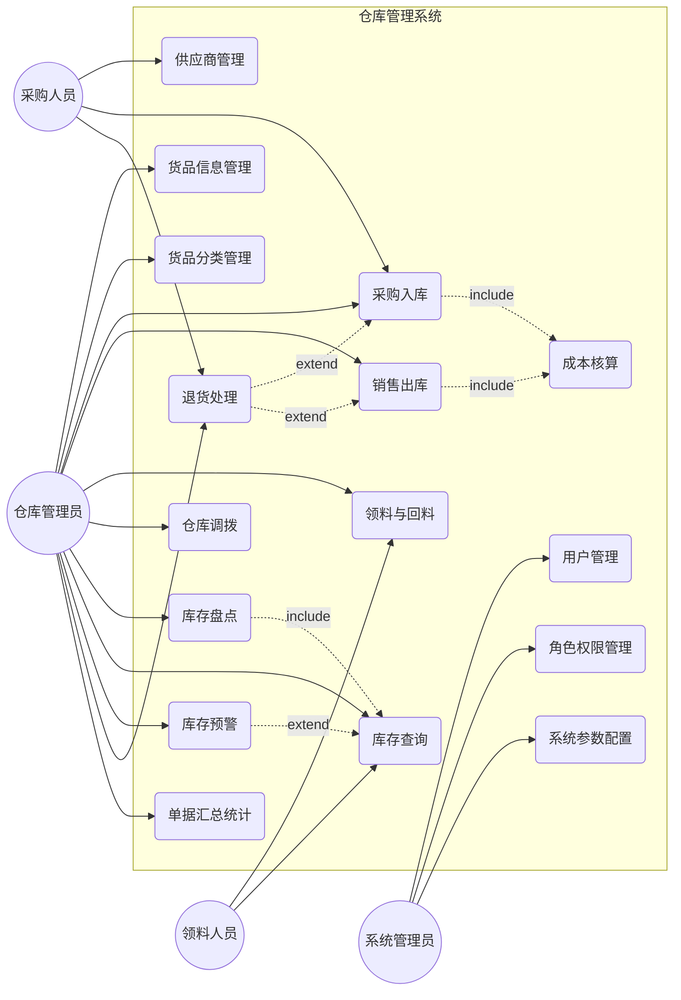
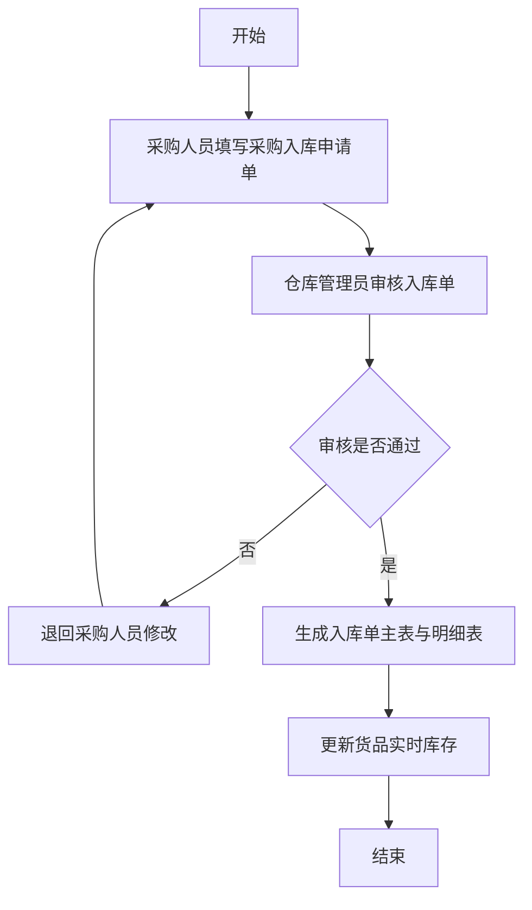
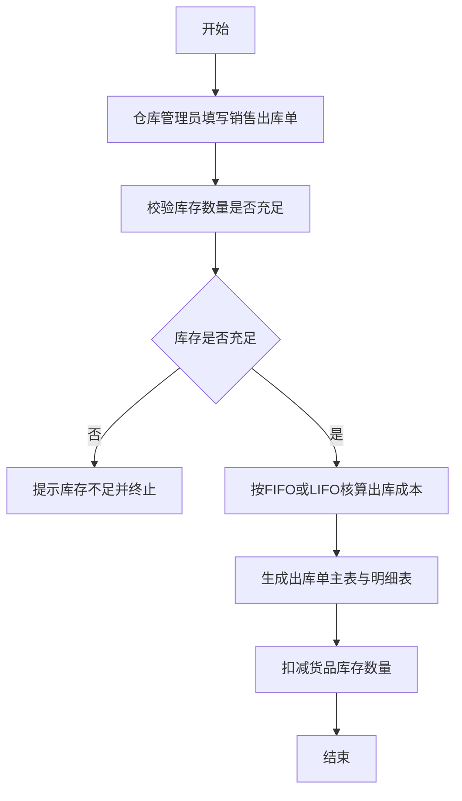
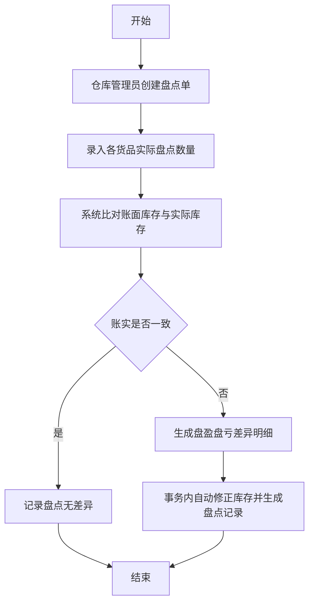
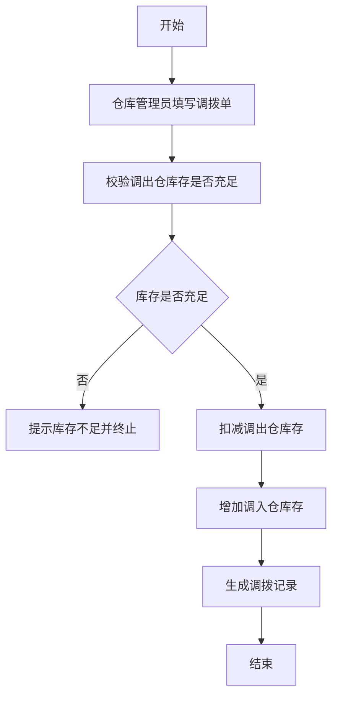
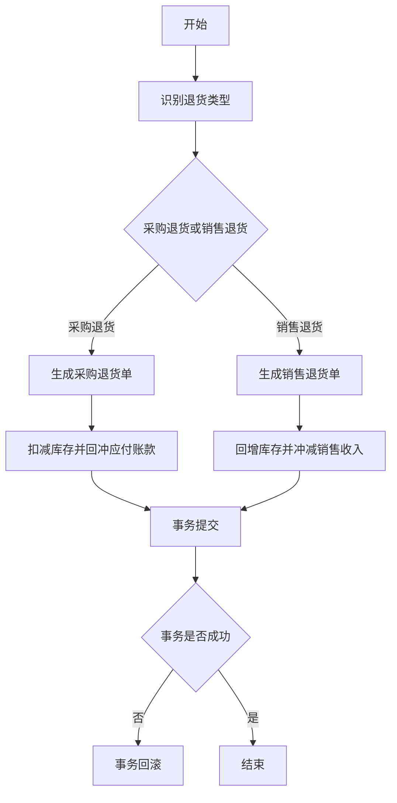

# 仓库管理系统需求分析文档

| 项目 | 内容 |
| --- | --- |
| 课程名称 | 数据库系统课程设计 |
| 题目 | 仓库管理系统 |
| 阶段 | 阶段一：需求分析与用例图 |
| 技术栈 | Java + MySQL 8.0 |
| 文档说明 | 本文档可直接粘贴进课程设计报告第三章“系统需求分析”及第一次答辩演讲稿 |

---

## 一、系统开发背景与目标

### 1.1 系统开发背景

随着企业生产与经营规模的不断扩大，仓库中物料的种类、数量以及进出库业务日益频繁。传统的手工记账或电子表格管理方式存在数据冗余、账实不符、查询统计困难、成本核算不准确等突出问题，已难以满足现代企业对仓储管理精细化、实时化、可追溯的要求。

在数据库课程设计背景下，仓库管理系统属于一个典型的管理信息系统（MIS），其业务覆盖采购入库、销售出库、退货、领料、回料、仓库调拨、库存盘点等完整仓储流程，实体关系复杂、数据关联度高，是考察数据库概念设计、逻辑设计、物理设计以及高级数据库对象（触发器、存储过程、视图、事务）应用能力的理想选题。

### 1.2 系统开发目标

1. **功能目标**：实现仓储全流程业务的信息化管理，支持多角色协同操作，覆盖采购入库、销售出库、退货、领料回料、仓库调拨、库存盘点等核心业务。
2. **成本核算目标**：实现先进先出（FIFO）、后进先出（LIFO）两种货品出库成本核算方式，为库存资金占用与经营分析提供准确依据。
3. **决策支持目标**：提供任意时间段库存查询、库存数量与占用资金汇总统计、多维度业务单据汇总报表，辅助管理层决策。
4. **风险控制目标**：实现库存上下限自动预警，对退货、盘盈盘亏等异常业务进行严格的事务处理与回滚，保证账实一致。
5. **技术目标**：采用 Java + MySQL 8.0 技术栈，严格遵循数据库三范式设计，落地主外键约束、索引、视图、触发器、存储过程、事务回滚等数据库技术，并接入 DeepSeek 大模型 API 实现自然语言转 SQL 的智能库存查询，作为课程设计创新亮点。

---

## 二、功能性需求分析

### 2.1 角色划分

系统按职能划分为四类操作角色，各角色职责边界清晰、权限相互隔离：

| 角色 | 主要职责 | 对应业务 |
| --- | --- | --- |
| 系统管理员 | 系统维护、权限控制 | 用户管理、角色权限管理、系统参数配置 |
| 仓库管理员 | 仓储核心业务执行 | 货品管理、出入库、调拨、盘点、预警、成本核算、统计 |
| 采购人员 | 采购与供应商管理 | 供应商管理、采购入库登记、采购退货 |
| 领料人员 | 生产领料与回料 | 领料申请、回料登记 |

### 2.2 系统管理员功能

系统管理员是系统的最高权限角色，负责系统基础信息与权限体系的维护，不直接参与仓储业务流转：

1. **用户管理**：对系统登录用户进行新增、修改、删除、禁用与启用操作，维护用户基础信息（账号、姓名、所属角色等）。
2. **角色权限管理**：维护系统角色，为角色分配可访问的功能模块与操作权限，实现基于角色的访问控制（RBAC）。
3. **系统参数配置**：设置系统全局参数，如单据编号规则、成本计价方式默认值（FIFO/LIFO）、预警开关等。
4. **数据字典维护**：维护系统基础字典项，保证下拉选项与业务枚举值的一致性。

### 2.3 仓库管理员功能

仓库管理员是仓储业务的核心执行者，几乎覆盖全部仓储流转环节：

1. **货品信息管理**：维护货品基础信息（货品编号、名称、规格、单位、分类、库存上下限阈值、计价方式等）。
2. **货品分类管理**：对货品进行多级分类维护，便于归类统计与查询。
3. **采购入库**：对采购人员提交的入库申请进行审核，审核通过后生成入库单及明细，并更新实时库存。
4. **销售出库**：根据销售订单办理出库，自动按 FIFO 或 LIFO 方式核算出库成本，并扣减库存。
5. **领料与回料处理**：审核领料人员的领料申请，执行出库扣减；办理回料入库，回增库存。
6. **仓库调拨**：办理跨仓库库存转移，同步扣减调出仓库存、增加调入仓库存。
7. **库存盘点**：创建盘点任务，录入实际盘点数量，系统自动比对账实差异，生成盘盈盘亏记录并修正库存。
8. **库存查询**：按任意时间段、货品、仓库等维度查询库存数量及变动明细。
9. **库存预警处理**：查看超储（高于上限）与短缺（低于下限）预警，及时采取补货或促销措施。
10. **退货处理**：办理采购退货与销售退货，异常业务严格走事务处理，保证库存与往来账目一致。
11. **单据汇总统计**：按供应商、货品、仓库、时间等维度生成汇总报表，辅助经营分析。

### 2.4 采购人员功能

采购人员负责上游供应链与采购入库相关业务：

1. **供应商管理**：维护供应商基础信息（名称、联系人、联系方式、结算方式等）。
2. **采购入库登记**：录入采购入库申请（采购单号、供应商、货品明细、数量、单价），提交仓库管理员审核入库。
3. **采购退货**：对不合格采购货品发起退货，生成采购退货单，联动库存与应付账款调整。
4. **采购查询**：查询本人经手的采购单据、入库明细及供应商供货情况。

### 2.5 领料人员功能

领料人员面向生产车间，负责物料的领用与回料：

1. **领料申请**：提交领料申请单（领料部门、用途、货品明细、数量），提交仓库管理员审核发料。
2. **回料登记**：对未用完或多领的物料进行回料登记，办理入库回增库存。
3. **个人单据查询**：查询本人提交的领料、回料单据及处理状态。

---

## 三、非功能性需求分析

### 3.1 性能需求

1. 常用单表查询（货品信息、单据列表）响应时间应在秒级以内；
2. 对货品编号、单据日期、供应商编号、仓库编号等高频查询字段建立索引，避免全表扫描；
3. 大批量测试数据（单表 ≥ 30 条、全库关联 ≥ 200 条）下，统计汇总类查询应保证可接受的执行效率；
4. 成本核算存储过程应支持批量明细的快速计算。

### 3.2 安全性需求

1. 采用基于角色的访问控制，不同角色只能访问被授权的功能模块；
2. 用户密码加密存储，登录过程进行身份认证；
3. 数据操作权限分级，普通角色不能直接执行库存修正、盘点等高风险操作；
4. 数据库层通过主外键约束、唯一约束保证数据完整性，防止非法数据写入。

### 3.3 可维护性需求

1. 系统采用 Java 分层架构（实体层 Entity、数据访问层 DAO、业务层 Service、工具层 util），各层职责单一、耦合度低；
2. 数据库对象（表、索引、视图、触发器、存储过程）命名规范、注释详细；
3. 核心业务逻辑封装于存储过程与 Service 层，便于统一维护与升级。

### 3.4 数据一致性需求

1. 入库、出库、盘点、调拨、退货等业务必须使用事务（Transaction）保证原子性；
2. 任何异常（库存不足、参数错误、系统异常）必须触发事务回滚，保证账实一致；
3. 库存数量的增减通过触发器或存储过程自动联动，避免人工遗漏导致账实不符；
4. 成本核算遵循 FIFO/LIFO 计价规则，保证出库成本与库存资金占用统计口径一致。

---

## 四、系统用例图

### 4.1 用例图（Mermaid）

参与者以圆形节点表示，系统用例以圆角节点表示，虚线箭头标注 `include`（包含）与 `extend`（扩展）关系，系统边界用 subgraph 表示。

### 4.2 用例说明表

| 编号 | 用例名称 | 主要参与者 | 用例说明 |
| --- | --- | --- | --- |
| UC01 | 用户管理 | 系统管理员 | 对系统用户进行增删改查与启用禁用 |
| UC02 | 角色权限管理 | 系统管理员 | 维护角色并分配功能权限 |
| UC03 | 系统参数配置 | 系统管理员 | 配置编号规则、默认计价方式、预警开关等 |
| UC04 | 货品信息管理 | 仓库管理员 | 维护货品基础信息与库存上下限阈值 |
| UC05 | 货品分类管理 | 仓库管理员 | 维护货品多级分类 |
| UC06 | 供应商管理 | 采购人员 | 维护供应商基础信息 |
| UC07 | 采购入库 | 采购人员、仓库管理员 | 采购入库申请、审核、入库与库存更新 |
| UC08 | 销售出库 | 仓库管理员 | 销售出库、成本核算与库存扣减 |
| UC09 | 领料与回料 | 领料人员、仓库管理员 | 领料申请审核与回料登记 |
| UC10 | 仓库调拨 | 仓库管理员 | 跨仓库库存转移 |
| UC11 | 库存盘点 | 仓库管理员 | 盘点与盘盈盘亏处理、库存修正 |
| UC12 | 库存查询 | 各角色 | 任意时间段库存数量查询 |
| UC13 | 库存预警 | 仓库管理员 | 库存超储与短缺自动预警 |
| UC14 | 退货处理 | 采购人员、仓库管理员 | 采购退货与销售退货异常处理 |
| UC15 | 成本核算 | 仓库管理员 | 按 FIFO/LIFO 核算出库成本 |
| UC16 | 单据汇总统计 | 仓库管理员 | 多维度业务单据汇总报表 |

---

## 五、业务流程图

### 5.1 采购入库流程

**流程说明**：采购人员录入采购入库申请，仓库管理员审核。审核不通过则退回修改；审核通过后系统生成入库单主表与明细表，并自动累加对应货品的库存数量，完成入库。

### 5.2 销售出库流程

**流程说明**：仓库管理员填写销售出库单后，系统先校验库存是否充足；库存不足则提示并终止。库存充足时，系统按货品设定的计价方式（FIFO 或 LIFO）自动核算出库成本，生成出库单据并扣减库存。

### 5.3 库存盘点流程

**流程说明**：仓库管理员创建盘点单并录入实盘数量，系统将账面库存与实际库存进行比对。账实一致则记录无差异；不一致则生成盘盈盘亏差异，并在事务内自动修正库存、生成盘点记录，异常时回滚。

### 5.4 仓库调拨流程

**流程说明**：仓库管理员填写调拨单，系统校验调出仓库存是否充足。库存不足则终止；充足则在事务内同步扣减调出仓库存、增加调入仓库存，并生成调拨记录。

### 5.5 退货异常处理流程

**流程说明**：退货属于异常业务，系统先识别退货类型。采购退货扣减库存并回冲应付账款，销售退货回增库存并冲减销售收入。整个退货流程在事务中执行，提交失败时自动回滚，保证数据一致性。
