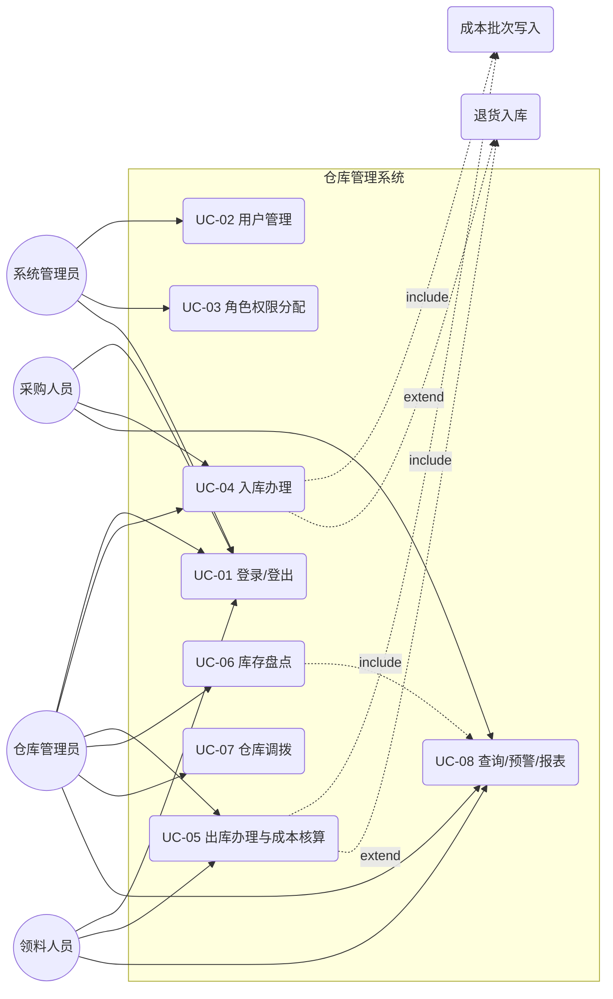
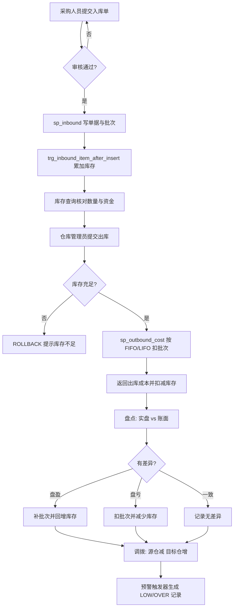

# 仓库管理系统 软件需求规格说明（SRS）

## 1 引言

### 1.1 目的

本文档定义仓库管理系统的功能需求、非功能需求、外部接口需求与数据需求，为设计、编码、测试与验收提供唯一的需求基线。文档中每条需求均具备**唯一编号、优先级、验收条件与异常分支**，可被直接转化为测试用例（映射关系见《04-需求-设计-测试追踪矩阵》）。

### 1.2 范围

系统面向中小企业的单库/多库仓储场景，提供从主数据维护到入库、出库、盘点、调拨、查询分析的全流程管理，并以 MySQL 存储过程、触发器、视图、事务承载核心业务逻辑。

**不在本版本范围**：自然语言转 SQL（接口占位，不验收）、真实支付与物流、物品借还、单点登录与双因子、集群与容器化部署、通用工作流引擎。

### 1.3 术语定义

| 术语 | 定义 |
| --- | --- |
| 货品（Goods） | 仓储管理的最小物料单元，含编号、名称、规格、单位、分类、上下限阈值、计价方式 |
| 库存（Stock） | 某仓库某货品的实时数量与占用资金 |
| 成本批次（Stock Batch） | 每次入库形成的数量 × 单价批次记录，是 FIFO/LIFO 核算依据 |
| 入库单 / 出库单 | 记录入库/出库业务的主表，含业务类型、仓库、经办人、状态与明细 |
| 业务类型（biz_type） | 区分采购入库、回料入库、销售退货、销售出库、领料出库、采购退货等 |
| 盘盈 / 盘亏 | 实盘数量大于 / 小于账面数量形成的差异 |
| 调拨 | 同一货品在仓库之间转移库存，源减目标增 |
| 预警 | 库存数量低于下限（LOW）或高于上限（OVER）时产生的提示记录 |
| 权限编码 | 形如 `模块:动作` 的字符串，用于菜单渲染与接口拦截 |
| 401/403 场景 | 匿名访问跳转登录；已登录但无权限访问返回 403 |

### 1.4 读者对象

课程评审教师、项目组成员（开发/数据库/测试）、答辩演示人。

### 1.5 参考文档

1. 01-需求分析与用例图.md（角色、16 用例、5 张业务流程）
2. 02_业务流程与ER图设计.md（实体关系与流程细化）
3. 03_MySQL数据表设计.md（19 表逻辑/物理设计）
4. 04_数据库对象.md（4 视图、8 触发器、4 存储过程、事务）
5. 05_SpringBoot后端实现.md（分层架构与页面清单）
6. 06_系统演示流程与数据.md（演示数据与算例）

---

## 2 总体描述

### 2.1 产品前景

系统替代手工台账与电子表格，作为企业内部唯一的库存账本。它与上游采购、下游销售/生产领料形成数据闭环：采购形成入库，销售与领料形成出库，退货形成反向单据，盘点与调拨修正与再分配库存。所有库存与金额变动均可沿"单据 → 明细 → 批次 → 库存"链路追溯。

### 2.2 产品功能概览

| 功能域 | 主要能力 | 底层数据库对象 |
| --- | --- | --- |
| 认证与授权 | 登录/登出、会话、菜单授权、越权拦截、用户管理、角色权限分配 | sys_user、sys_role、sys_permission、sys_role_permission |
| 主数据管理 | 货品、分类、供应商、仓库维护 | goods、goods_category、supplier、warehouse |
| 入库业务 | 采购入库、回料入库、销售退货入库 | sp_inbound + trg_inbound_item_after_insert |
| 出库业务 | 销售出库、领料出库、采购退货出库，FIFO/LIFO 成本 | sp_outbound_cost + trg_outbound_order_after_approve |
| 盘点 | 账实比对、盘盈盘亏、库存修正 | sp_stocktake + stocktake_order/item |
| 调拨 | 跨仓转移、源减目标增 | sp_transfer + transfer_order/item |
| 查询分析 | 库存总览、上下限预警、三类统计报表 | v_stock_overview、v_stock_warning、v_inout_summary、v_stock_batch_cost |

### 2.3 用户类别与特征

| 角色 ID | 角色 | 特征 | 使用频度 | 关键诉求 |
| --- | --- | --- | --- | --- |
| 1 | 系统管理员 | 系统维护者，不参与业务流转 | 低 | 账号可控、授权可调、越权可防 |
| 2 | 仓库管理员 | 仓储业务核心执行者，覆盖全部业务 | 高 | 操作准确、账实一致、异常可回滚 |
| 3 | 采购人员 | 上游供应链，关注入库与退货 | 中 | 入库登记简便、退货可追溯 |
| 4 | 领料人员 | 生产车间，关注领用与回料 | 中 | 领料/回料入口清晰、单据状态可见 |

### 2.4 运行环境

| 项 | 要求 |
| --- | --- |
| 客户端 | 现代浏览器（Chrome/Edge 最新版），分辨率 ≥ 1280×720 |
| 服务端 | JDK 8 运行时（编译验证使用 JDK 21 + Maven 3.9.11），Spring Boot 2.7 内嵌 Tomcat，端口 8080 |
| 数据库 | MySQL 8.0/8.4，InnoDB，utf8mb4，库名 `warehouse_db` |
| 网络 | 单机 localhost 部署，无外网依赖 |
| 数据规模 | 单表 ≥ 30 条，全库关联 ≥ 200 条 |

### 2.5 设计与实现约束

| 编号 | 约束 | 理由 |
| --- | --- | --- |
| C-01 | 核心业务（入库、出库成本、盘点、调拨）必须在 MySQL 存储过程内完成 | 体现数据库课程重点 |
| C-02 | 库存数量增减由触发器自动联动，Java 层不得重复更新库存 | 避免双计数 |
| C-03 | 成本算法不得写在 Java 代码中 | 与 C-01 一致 |
| C-04 | 查询优先使用视图，Mapper 直接查视图 | 降低复杂度、统一口径 |
| C-05 | 权限校验必须在服务端完成，前端隐藏不作为安全手段 | 防直连 URL 越权 |
| C-06 | 数据库连接口令从本地 `.env` 读取，禁止提交明文 | 配置安全 |
| C-07 | 表结构遵循三范式，命名遵循 `下划线小写`，字段带 COMMENT | 可维护性 |

### 2.6 假设与依赖

1. 首次部署已按顺序执行 `sql/01~05`（建表、视图、触发器、存储过程、测试数据）与 `08-rbac-lab.sql`（授权）。
2. 演示账号已存在：user01 / lab_admin / lab_keeper / lab_buyer / lab_requester，密码 123456。
3. 单据审核以状态字段简化，不引入外部审批系统。
4. 时钟统一取服务器本地时间，不处理多时区。

---

## 3 功能需求

> 优先级：M=必须（Must），S=应该（Should），C=可选（Could）。验收条件以"可观测结果"表述。

### 3.1 FR-01 身份认证与基于角色的访问控制（优先级 M）

**描述**：系统须对访问者进行身份认证，并按角色授予功能级权限，实现"菜单可见"与"接口可访问"的一致控制，任何绕过页面的直连请求同样受控。

| 子编号 | 需求 | 优先级 | 验收条件 |
| --- | --- | --- | --- |
| FR-01-01 | 有效且启用的账号凭据登录成功，建立会话并加载该角色权限编码集合 | M | 正确凭据进入 /home；错误凭据或禁用账号停留登录页并给出提示 |
| FR-01-02 | 导航菜单仅渲染当前角色拥有的功能项 | M | 四类账号登录后菜单项与"角色-权限矩阵"完全一致 |
| FR-01-03 | 匿名访问受保护资源跳转登录页 | M | 匿名 GET /home、/biz/inbound、POST /biz/stocktake 均 302 至 /login |
| FR-01-04 | 已登录但无权限的访问返回 403 | M | 越权 GET 与 POST 均 403，且数据库无任何写入 |
| FR-01-05 | 退出登录清除会话 | M | 退出后再访问 /stock 返回 302 至登录页 |
| FR-01-06 | 用户管理：查看、新增、修改、删除、启用/禁用账号 | M | 新增后可登录；修改姓名/角色/状态后即时生效；删除后无法登录 |
| FR-01-07 | 角色权限分配：按角色勾选权限，整体保存 | M | 保存后重新登录，菜单与接口权限与勾选集合一致；保存失败整体回滚 |
| FR-01-08 | 用户管理与角色权限分配仅系统管理员（角色 1）持有 | M | lab_keeper 直达 /sys/user、/sys/role 均 403 |

**输入**：用户名、密码；用户表单（用户名/密码/姓名/角色/状态）；角色选择 + 权限勾选集合。
**处理**：
1. `SysUserMapper.findByUsername` 校验账号存在且状态启用；
2. 校验密码，通过后 `selectPermissionCodesByRoleId(roleId)` 取权限编码集合写入 Session；
3. 拦截器对每个请求比对方法上的 `@RequirePermission` 编码与 Session 集合；
4. 用户管理、角色权限分配由独立控制器承载，保存授权在事务内先删后插。

**异常分支**：
| 场景 | 系统行为 |
| --- | --- |
| 账号不存在 / 密码错误 | 停留登录页，提示"用户名或密码错误"，不泄露账号是否存在 |
| 账号被禁用 | 拒绝登录，提示"账号已禁用" |
| Session 过期 | 视为匿名，跳转登录页 |
| 删除仍被业务单据引用的账号 | 外键约束拒绝删除，页面提示失败，数据不变 |
| 修改用户密码留空 | 保留原密码，不覆盖 |
| 授权保存过程中异常 | 事务回滚，角色权限保持保存前状态 |

**角色-权限矩阵（13 个权限编码）**

| 权限编码 | 功能 | 角色1 管理员 | 角色2 仓库管理员 | 角色3 采购人员 | 角色4 领料人员 |
| --- | --- | :--: | :--: | :--: | :--: |
| goods:manage | 货品管理 | ✓ | ✓ | — | — |
| biz:inbound | 采购入库 | ✓ | ✓ | ✓ | — |
| biz:outbound | 销售出库 | ✓ | ✓ | — | — |
| biz:apply | 领料出库 | ✓ | ✓ | — | ✓ |
| biz:materialReturn | 回料入库 | ✓ | ✓ | — | ✓ |
| biz:return | 退货处理 | ✓ | ✓ | ✓ | — |
| biz:check | 库存盘点 | ✓ | ✓ | — | — |
| biz:transfer | 仓库调拨 | ✓ | ✓ | — | — |
| stock:view | 库存查询 | ✓ | ✓ | ✓ | ✓ |
| biz:warning | 库存预警 | ✓ | ✓ | — | — |
| report:view | 统计报表 | ✓ | ✓ | — | — |
| user:manage | 用户管理 | ✓ | — | — | — |
| role:assign | 角色权限分配 | ✓ | — | — | — |

> 授权数据存放于 `sys_role_permission(role_id, permission_id)`；权限字典存放于 `sys_permission(permission_code)`。新增权限须同时登记本表与追踪矩阵。

---

### 3.2 FR-02 入库业务（采购入库 / 回料入库 / 销售退货入库）（优先级 M）

**描述**：有对应权限的用户选择有效供应商（采购场景）、货品、仓库并录入正数量与单价，系统生成入库单及明细、写入成本批次、联动累加库存，且数量与金额口径一致。

| 子编号 | 需求 | 优先级 | 验收条件 |
| --- | --- | --- | --- |
| FR-02-01 | 采购入库录入供应商、仓库、货品、数量、单价并提交 | M | 提交成功提示；库存查询中该仓库该货品数量与资金按"数量×单价"累加 |
| FR-02-02 | 回料入库按领料部门回增库存，业务类型标记 MATERIAL_RETURN | M | 库存数量回增，单据列表中出现回料类型记录 |
| FR-02-03 | 销售退货入库按 SALE_RETURN 回增库存 | M | 库存与资金正确回增，退货单据可查 |
| FR-02-04 | 每次入库生成成本批次记录（数量、单价、入库时间、来源单号） | M | `stock_batch` 存在对应批次，FIFO 按时间升序可用 |
| FR-02-05 | 合法输入才写入，非法输入零写入 | M | 数量 ≤ 0、货品/仓库不存在时提交失败且三张表均无新增 |

**处理**：Controller 组装参数 → `BusinessService` 校验 → `ProcedureMapper` 调用 `sp_inbound`（内部事务：写主表/明细/批次 → 提交；异常 `EXIT HANDLER` 回滚）→ 触发器 `trg_inbound_item_after_insert` 累加 `stock` 数量与资金。

**异常分支**
| 场景 | 行为 |
| --- | --- |
| 数量 ≤ 0 或为空 | 提示"数量必须大于 0"，不写库 |
| 单价为负 | 提示"单价不能为负"，不写库 |
| 货品/仓库/供应商无效 | 提示"所选数据无效"，不写库 |
| 存储过程返回非 0 状态码 | Service 抛 `BusinessException`，页面展示状态消息，库内已回滚 |

---

### 3.3 FR-03 出库业务与 FIFO/LIFO 成本核算（优先级 M）

**描述**：有权限用户提交销售出库、领料出库或采购退货出库时，系统校验库存充足性，按货品设定的计价方式核算出库成本、扣减库存、写入出库明细成本，库存不足时整单失败且不留部分数据。

| 子编号 | 需求 | 优先级 | 验收条件 |
| --- | --- | --- | --- |
| FR-03-01 | 提交前校验库存数量是否充足 | M | 不足时提示"库存不足"，`outbound_order`、`outbound_item`、`stock`、`stock_batch` 均无变化 |
| FR-03-02 | 计价方式为 FIFO 的货品按入库时间升序扣批次 | M | 100@5 + 50@6 出库 120，出库成本 = 620.00，余量 30、资金 180 |
| FR-03-03 | 计价方式为 LIFO 的货品按入库时间降序扣批次 | M | 100@5 + 50@6 出库 120，出库成本 = 650.00 |
| FR-03-04 | 出库明细记录成本金额，可按单追溯 | M | `outbound_item` 存在单价/成本字段值，与报表统计一致 |
| FR-03-05 | 出库审核通过后自动扣减库存 | M | `trg_outbound_order_after_approve` 生效，无重复扣减 |
| FR-03-06 | 采购退货出库按 PURCHASE_RETURN 业务类型 | M | 库存扣减，单据类型正确 |

**处理**：`BusinessService` 参数校验 → `ProcedureMapper.callOutboundCost`（CALLABLE，OUT 参数 statusCode / statusMsg / outTotalCost）→ 过程内完成校验、批次扣减、单据与明细写入、事务提交或回滚 → 触发器扣减库存 → 返回成本金额提示。

**异常分支**
| 场景 | 行为 |
| --- | --- |
| 库存不足 | 过程内 ROLLBACK，返回状态码非 0，页面提示，库存与批次不变 |
| 数量 ≤ 0 | 校验拦截，不进入过程 |
| 计价方式非 FIFO/LIFO | 保存货品时即拒绝（FR-04 约束），出库时按默认 FIFO 处理并记录 |
| 并发导致批次不足 | 过程内重新校验，失败回滚 |

---

### 3.4 FR-04 库存盘点（盘盈盘亏）（优先级 M）

**描述**：仓库管理员创建盘点单并录入各货品实盘数量，系统比对账面数量，生成差异明细，盘盈入库、盘亏出库，并在事务内修正库存。

| 子编号 | 需求 | 优先级 | 验收条件 |
| --- | --- | --- | --- |
| FR-04-01 | 创建盘点单，录入非负实盘数量 | M | 提交成功，盘点单状态为已盘点 |
| FR-04-02 | 账实一致时记录无差异 | M | 明细差异为 0，库存不变 |
| FR-04-03 | 实盘 > 账面记盘盈，实盘 < 账面记盘亏 | M | `stocktake_item` 差异值与方向正确，库存被修正为实盘数 |
| FR-04-04 | 负数实盘拒绝写入 | M | 提交失败，`stocktake_order`、`stocktake_item`、`stock` 均无变化 |
| FR-04-05 | 盘点过程异常整体回滚 | M | 中途异常后库存与单据保持盘点前状态 |

**处理**：`sp_stocktake` 内加锁读取账面 → 计算差异 → 生成差异明细 → 盘盈写批次、盘亏扣批次 → 修正库存 → 提交；异常回滚。

**异常分支**：负数或非数字输入拦截；盘点单重复提交以单据状态拦；无实盘数据的货品不计入差异。

---

### 3.5 FR-05 仓库调拨（优先级 M）

**描述**：仓库管理员在不同仓库间调拨正数量货品，系统在同一事务内扣减调出仓、增加调入仓，并生成调拨单据与明细。

| 子编号 | 需求 | 优先级 | 验收条件 |
| --- | --- | --- | --- |
| FR-05-01 | 支持选择源仓、目标仓、货品及多条明细批量调拨 | M | 提交成功，生成 1 张调拨单 + N 条明细 |
| FR-05-02 | 校验源仓库存充足 | M | 不足时提示，源仓与目标仓库存均不变 |
| FR-05-03 | 成功时源减目标增，总量守恒 | M | 源仓 -N、目标仓 +N，两仓合计不变 |
| FR-05-04 | 源仓与目标仓不可相同 | M | 相同时拒绝并提示 |
| FR-05-05 | 中途异常整体回滚 | M | 异常后两端库存与单据均恢复原状 |

**处理**：明细以 JSON 传入 `sp_transfer`，过程内逐条校验与扣减，全部成功才提交。

---

### 3.6 FR-06 库存查询、预警与统计报表（优先级 M/S）

**描述**：有权限用户可按仓库、货品维度查询实时库存与占用资金；系统依据货品上下限生成 LOW/OVER 预警；提供出入库汇总、供应商供货、盘点差异三类统计。

| 子编号 | 需求 | 优先级 | 验收条件 |
| --- | --- | --- | --- |
| FR-06-01 | 库存总览展示仓库、货品、数量、占用资金 | M | 与 `v_stock_overview` 一致；入库后数值即时变化 |
| FR-06-02 | 预警按阈值判定：数量 < 下限为 LOW，> 上限为 OVER | M | 阈值 10/1000 下，数量 5 显示 LOW，1200 显示 OVER |
| FR-06-03 | 预警记录持久化可查历史 | S | `stock_alert` 有对应记录，含触发时间与类型 |
| FR-06-04 | 出入库汇总报表按时间段/货品统计 | S | 汇总值与单据明细可核对 |
| FR-06-05 | 供应商供货统计 | S | 与入库单按供应商聚合结果一致 |
| FR-06-06 | 盘点盈亏统计 | S | 与盘点差异明细一致 |
| FR-06-07 | 预警与报表访问受对应权限编码控制 | M | 无 `biz:warning`/`report:view` 时菜单不显示且直达 URL 403 |

**处理**：`StockMapper` 直接查询视图；`StockService` 组装统计结果；预警记录由触发器 `trg_stock_after_insert/update` 写入 `stock_alert`。

**异常分支**：时间段起止颠倒时提示；无数据时展示空表而非报错；权限缺失 403。

---

### 3.7 需求优先级汇总

| 编号 | 需求名称 | 优先级 | 关键验收指标 |
| --- | --- | --- | --- |
| FR-01 | 身份认证与 RBAC | M | 6 条权限用例全通过 |
| FR-02 | 入库业务 | M | 数量与资金双口径一致 |
| FR-03 | 出库与成本核算 | M | FIFO 620 / LIFO 650 |
| FR-04 | 库存盘点 | M | 差异方向正确、负数零写入 |
| FR-05 | 仓库调拨 | M | 总量守恒、失败双端不变 |
| FR-06 | 查询/预警/报表 | M（01、02、07）；S（03~06） | 阈值判定正确、统计可追溯 |

---

## 4 外部接口需求

### 4.1 用户界面

| 页面 | 路径 | 权限编码 | 主要元素 |
| --- | --- | --- | --- |
| 登录 | /login | 匿名 | 用户名、密码、提示区 |
| 主页 | /home | 已登录 | 导航、功能入口 |
| 货品管理 | /goods | goods:manage | 列表、新增/编辑表单、计价方式下拉 |
| 采购入库 | /biz/inbound | biz:inbound | 供应商/仓库/货品下拉、数量、单价 |
| 销售出库 | /biz/outbound | biz:outbound | 仓库/货品下拉、数量、成本结果提示 |
| 领料出库 | /biz/materialIssue | biz:apply | 领料部门、用途、明细 |
| 回料入库 | /biz/materialReturn | biz:materialReturn | 回料部门、明细 |
| 退货处理 | /biz/return | biz:return | 退货类型单选、明细 |
| 库存盘点 | /biz/stocktake | biz:check | 盘点明细、实盘录入 |
| 仓库调拨 | /biz/transfer | biz:transfer | 源仓/目标仓、多明细 |
| 库存查询 | /stock | stock:view | 库存表格、资金列 |
| 库存预警 | /warning | biz:warning | LOW/OVER 红黄标签、历史记录 |
| 统计报表 | /report | report:view | 三组统计表格 |
| 用户管理 | /sys/user | user:manage | 用户列表、新增/修改/删除 |
| 角色权限分配 | /sys/role | role:assign | 角色选择、权限勾选、保存 |

**界面通用要求**：字段标签与数据库语义一致；必填项有前端与后端双重校验；提交后以 flash 消息提示成功/失败；表格支持空数据展示；导航通过 `fragments.html` 复用。

### 4.2 软件接口

| 接口 | 说明 |
| --- | --- |
| Spring MVC 路由 | GET 渲染页面，POST 提交业务；受限路由由 `AuthInterceptor` 依据 `@RequirePermission` 拦截 |
| MyBatis | 普通 CRUD 使用注解/XML；存储过程使用 `statementType=CALLABLE` + OUT 参数回写 Map |
| 事务边界 | 事务在存储过程内（`START TRANSACTION` / `COMMIT` / `ROLLBACK` + `EXIT HANDLER`），Java 侧只读状态码 |
| 外部 AI 接口 | DeepSeek 仅保留占位客户端，不纳入验收 |

### 4.3 数据库接口

| 类别 | 对象 | 说明 |
| --- | --- | --- |
| 表（辅助，8） | sys_role、sys_permission、sys_role_permission、sys_user、goods_category、supplier、warehouse、goods | 主数据与权限 |
| 表（业务，11） | stock、stock_batch、inbound_order、inbound_item、outbound_order、outbound_item、transfer_order、transfer_item、stocktake_order、stocktake_item、stock_alert | 台账、批次、单据、预警 |
| 视图（4） | v_stock_overview、v_stock_warning、v_inout_summary、v_stock_batch_cost | 查询口径统一 |
| 触发器（8） | trg_inbound_item_after_insert、trg_outbound_order_after_approve、trg_stock_after_insert、trg_stock_after_update、trg_inbound_item_after_delete、trg_inbound_item_after_update、trg_outbound_item_after_delete、trg_outbound_item_after_update | 库存自动联动与反向回滚、预警生成 |
| 存储过程（4） | sp_inbound、sp_outbound_cost、sp_stocktake、sp_transfer | 入库、出库成本、盘点、调拨 |
| 约束/索引 | 主键、外键、唯一约束；货品编号、单据日期、供应商号、仓库号索引 | 完整性与性能 |

---

## 5 非功能需求

| 编号 | 类别 | 需求 | 验收方法 |
| --- | --- | --- | --- |
| NFR-01 | 性能 | 常用单表查询与列表页响应 ≤ 2 秒；高频字段建索引避免全表扫描；≥30 条/表、≥200 条关联数据下统计查询可接受 | 手工计时、EXPLAIN 检查索引命中 |
| NFR-02 | 安全性 | 服务端强制 RBAC；密码不明文展示；越权 GET/POST 均 403；连接口令不入库不入版本库 | A-AUTH 系列用例 |
| NFR-03 | 数据一致性 | 入库/出库/盘点/调拨/退货全部事务保护；异常必回滚；库存增减只由触发器或存储过程负责，禁止双写 | 回滚用例 + 四方比对（源仓/目标仓/批次/单据） |
| NFR-04 | 可靠性 | 脚本可重复执行（DROP IF EXISTS 反序）；服务启动无异常；异常提示不暴露堆栈 | 干净环境复验两次 |
| NFR-05 | 易用性 | 关键字段用下拉选择；成功/失败均有明确提示；预警以红（LOW）/黄（OVER）区分；导航层级不超过两级 | 走查 14 页面 |
| NFR-06 | 可维护性 | 分层职责单一（Controller 不写 SQL、Service 不做跳转）；表/字段/对象命名规范且带注释；核心逻辑集中于存储过程 | 代码走查 |
| NFR-07 | 兼容性 | Chrome/Edge 最新版渲染一致；MySQL 8.0/8.4 均可运行；utf8mb4 无乱码 | 双浏览器 + 双版本抽检 |
| NFR-08 | 可追溯性 | 每条需求在设计、代码、测试中可定位；测试证据可复现 | 追踪矩阵交叉核对 |

---

## 6 数据需求

### 6.1 关键实体与关系

| 实体 | 关键属性 | 关系 |
| --- | --- | --- |
| 仓库 warehouse | 仓库编号、名称、地址、状态 | 1:N 库存、入库单、出库单、调拨单 |
| 货品 goods | 货品编号、名称、规格、单位、分类、下限、上限、计价方式 | N:1 分类；1:N 库存/批次/单据明细 |
| 供应商 supplier | 编号、名称、联系人、电话、结算方式 | 1:N 入库单 |
| 库存 stock | 仓库+货品唯一、数量、占用资金 | 与批次 1:N（按仓库货品聚合） |
| 成本批次 stock_batch | 批次号、仓库、货品、入库数量、剩余数量、单价、入库时间 | 出库按 FIFO/LIFO 扣减 |
| 入库单/出库单 | 单号、业务类型、仓库、供应商/客户、经办人、状态、金额 | 1:N 明细 |
| 调拨单 | 单号、源仓、目标仓、经办人、状态 | 1:N 明细 |
| 盘点单 | 单号、仓库、盘点日期、状态 | 1:N 明细（账面数、实盘数、差异） |
| 预警 stock_alert | 仓库、货品、预警类型、触发数量、时间 | 由触发器写入 |

### 6.2 数据约束

1. `stock(warehouse_id, goods_id)` 唯一，防止同仓同货多行。
2. 外键 `ON DELETE RESTRICT`，保护历史单据不被误删；用户被单据引用时删除失败并提示。
3. 数量字段非负校验由应用层与过程层双重保证。
4. 金额与单价使用 DECIMAL，禁止浮点累加误差。
5. 时间字段统一 DATETIME，FIFO/LIFO 依赖入库时间排序，禁止空值。

### 6.3 数据保留与初始化

- 基础数据（用户、角色、权限、分类、供应商、仓库、货品）保留不清空；
- 演示前重置仅清空 11 张业务表（见 06 文档 TRUNCATE 清单），重置后**必须重新执行权限脚本 08**，否则菜单为空。

---

## 7 用例规格

### 7.1 用例图

### 7.2 用例规格表

| 编号 | 用例 | 参与者 | 前置条件 | 主流程 | 异常与结果 |
| --- | --- | --- | --- | --- | --- |
| UC-01 | 登录/登出 | 全部角色 | 账号存在且启用 | 输入凭据 → 校验 → 建会话 → 载入权限集合 → 渲染菜单；登出清会话 | 凭据错误/禁用 → 停留登录页提示；匿名访问受保护资源 → 302 /login |
| UC-02 | 用户管理 | 系统管理员 | 持有 user:manage | 进入列表 → 新增/修改/删除 → 返回列表并提示 | 权限不足 403；被单据引用删除失败；密码留空保留原值 |
| UC-03 | 角色权限分配 | 系统管理员 | 持有 role:assign | 选角色 → 勾选权限 → 事务保存 → 重新登录生效 | 保存异常整体回滚；权限不足 403 |
| UC-04 | 入库办理 | 采购人员、仓库管理员 | 持有对应权限、基础数据就绪 | 选供应商/仓库/货品 → 录数量单价 → 调 sp_inbound → 批次与库存联动 | 非法数量/无效数据零写入；过程非 0 状态码回滚 |
| UC-05 | 出库办理与成本核算 | 仓库管理员、领料人员（领料） | 持有对应权限、有可用库存 | 选仓库/货品 → 录数量 → 调 sp_outbound_cost → 返回成本 → 扣库存 | 库存不足整单失败；FIFO/LIFO 结果与算例一致 |
| UC-06 | 库存盘点 | 仓库管理员 | 持有 biz:check | 建盘点单 → 录实盘 → 比对差异 → 修正库存 | 负数实盘零写入；异常回滚 |
| UC-07 | 仓库调拨 | 仓库管理员 | 持有 biz:transfer | 选源仓/目标仓/明细 → 调 sp_transfer → 源减目标增 | 源仓不足两端不变；同仓调拨拒绝 |
| UC-08 | 查询/预警/报表 | 各角色（按权限） | 持有 stock:view 等 | 查询库存 → 查看预警 → 生成报表 | 权限不足菜单隐藏且直达 403；无数据展示空表 |

### 7.3 关键业务流程（采购入库 → 出库 → 盘点 → 调拨）

---

## 8 验收准则

| 编号 | 验收项 | 判据 | 对应测试 |
| --- | --- | --- | --- |
| AC-01 | 认证与授权 | 6 条权限用例全部符合预期（302/403/200） | TC-AUTH-01~06 |
| AC-02 | 管理写操作持久化 | 4 项写操作落库并可反向验证（登录、禁用、删除、授权回滚） | TC-DB-01~04 |
| AC-03 | 入库正确性 | 两批入库后数量 150、资金 800 | TC-IN-01~03 |
| AC-04 | 出库与成本 | FIFO 620.00、LIFO 650.00，不足时零写入 | TC-OUT-01~04 |
| AC-05 | 盘点 | 盘盈/盘亏方向正确，负数零写入 | TC-ST-01~03 |
| AC-06 | 调拨 | 总量守恒，源不足双端不变 | TC-TR-01~03 |
| AC-07 | 查询与预警 | 阈值判定正确，报表可追溯 | TC-QR-01~04 |
| AC-08 | 非功能 | 列表页 ≤ 2 秒、14 页面可用、无乱码 | TC-NFR-01~03 |

---

## 9 需求变更与待确认项

### 9.1 变更记录

| 编号 | 需求 | 变更内容 | 理由 | 影响范围 | 状态 |
| --- | --- | --- | --- | --- | --- |
| CR-01 | FR-01 | 统一 Session 拦截与导航授权，补齐用户管理与角色权限分配页 | 原实现仅隐藏菜单，存在直连越权 | 拦截器、导航、两个管理控制器与页面 | 已实施 |
| CR-02 | FR-01 | 用户管理与角色权限分配合并为角色 1 独占的两项权限 | 权限粒度需可展示 | 权限字典 13 项、角色矩阵 | 已实施 |
| CR-03 | 部署 | 数据库配置改为本地 `.env` 加载 | 避免明文口令入库 | application.yml、README | 已实施 |
| CR-04 | FR-06 | 预警与报表权限编码纳入字典（biz:warning / report:view） | 菜单与接口需同一编码 | 权限字典、角色 1/2 授权 | 已实施 |

### 9.2 待确认问题

## 10 基线需求继承说明

本 SRS 吸收了原项目的《需求分析与用例图》：开发背景与目标对应第 1、2 节；四类角色及业务权限对应第 2、3 节；功能与非功能需求对应第 3、5 节；用例图、用例规格和采购入库—出库—盘点—调拨流程对应第 7 节。以本 SRS 为当前改造版本的唯一需求基线，旧版根目录文档不再另行维护。

| 编号 | 问题 | 影响 | 建议 |
| --- | --- | --- | --- |
| Q-01 | 客户/销售对象是否需独立主数据表 | 影响销售出库字段完整性 | 本版以文本字段记录，后续扩展 customer 表 |
| Q-02 | 单据审核是否引入多级审批 | 影响状态机复杂度 | 本版单级状态，范围外 X-6 |
| Q-03 | 预警记录是否需人工确认闭环 | 影响 stock_alert 使用方式 | 本版只读展示，后续加确认字段 |
| Q-04 | 并发下批次扣减是否需行级锁 | 影响高并发正确性 | 过程内已加必要锁，压测范围外 X-5 |
