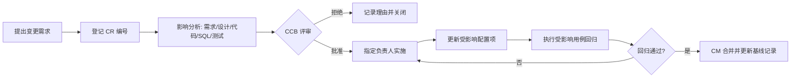

# 仓库管理系统 软件配置管理计划（SCMP）

## 1 引言

### 1.1 目的

本计划规定本项目在 2026-11-1 至 2026-11-25 期间的**配置项识别、基线建立、版本控制、变更控制、配置状态记录、配置审核与发布归档**规则，确保文档、源码、SQL 脚本、测试证据之间的版本一致，任何交付物均可在任一时刻复现其构成。

### 1.2 范围

适用于以下全部配置项：工程文档（4 份）、数据库脚本（6 个）、后端源码、前端模板与样式、测试与演示材料、课程报告。不适用于个人本地环境文件（`.env`、IDE 配置、构建产物）。

### 1.3 术语

| 术语 | 说明 |
| --- | --- |
| CI | 配置项，受版本控制并可独立识别的最小单元 |
| 基线 | 经评审冻结、后续变更须走 CR 的配置项集合 |
| CCB | 变更控制委员会，本项目由 A 主持，B/C/D 会签 |
| CR | 变更请求 |
| FCA / PCA | 功能配置审核 / 物理配置审核 |
| 标签（Tag） | 基线的机械标识，如 `bl-s1`、`v1.0-rc1` |

---
## 2 配置管理组织与职责

| 角色 | 人员 | 职责 |
| --- | --- | --- |
| 配置管理员（CM） | A | 建立与维护版本库、打标签、维护基线记录、组织配置审核、归档发布包 |
| 开发负责人 | B | 提交后端代码与接口文档，保证提交粒度与信息完整 |
| 数据库负责人 | C | 维护 SQL 脚本版本与执行顺序，保证脚本可重复执行 |
| 测试负责人 | D | 维护测试用例与证据文件，保证回归可复现 |
| CCB | A/B/C/D | 审批 CR，评估对需求-设计-代码-测试的影响 |

---
## 3 配置项识别

### 3.1 配置项清单

| CI 编号 | 配置项 | 类型 | 责任人 | 存储位置 | 命名规则 |
| --- | --- | --- | --- | --- | --- |
| CI-DOC-01 | 项目计划 | 文档 | A | `docs/01-项目计划.md` | `NN-文档名.md` |
| CI-DOC-02 | 软件需求规格说明 | 文档 | A | `docs/02-软件需求规格说明SRS.md` | 同上 |
| CI-DOC-03 | 配置管理计划 | 文档 | A | `docs/03-配置管理计划.md` | 同上 |
| CI-DOC-04 | 需求-设计-测试追踪矩阵 | 文档 | A | `docs/04-需求-设计-测试追踪矩阵.md` | 同上 |
| CI-DOC-05 | 课程设计报告 | 文档 | A | `report/仓库管理系统课程设计报告.docx` | — |
| CI-DB-01 | 建表脚本（库/表/约束/索引） | SQL | C | `sql/01-schema.sql` | `NN-用途.sql` |
| CI-DB-02 | 视图脚本 | SQL | C | `sql/02-views.sql` | 同上 |
| CI-DB-03 | 触发器脚本 | SQL | C | `sql/03-triggers.sql` | 同上 |
| CI-DB-04 | 存储过程脚本 | SQL | C | `sql/04-procedures.sql` | 同上 |
| CI-DB-05 | 测试数据脚本 | SQL | C | `sql/05-seed.sql` | 同上 |
| CI-DB-06 | 权限授权脚本 | SQL | C/A | `sql/08-rbac-lab.sql` | 同上 |
| CI-SRC-01 | 启动与 MVC 配置 | 源码 | B | `src/main/java/com/warehouse/{WarehouseApplication,config/WebConfig}.java` | 包名小写、类名大驼峰 |
| CI-SRC-02 | 认证与授权 | 源码 | B | `controller/LoginController`、`SysUserController`、`SysRolePermController`、`service/AuthService`、`util/AuthInterceptor` | 同上 |
| CI-SRC-03 | 业务控制器与业务层 | 源码 | B | `controller/{BusinessController,GoodsController,StockController}`、`service/{BusinessService,GoodsService,StockService}` | 同上 |
| CI-SRC-04 | 数据访问层 | 源码 | B | `mapper/{GoodsMapper,SupplierMapper,WarehouseMapper,SysUserMapper,StockMapper,ProcedureMapper}` | 同上 |
| CI-SRC-05 | 实体与工具 | 源码 | B | `entity/*`、`util/{BusinessException,ProcedureResult}` | 同上 |
| CI-UI-01 | 公共模板与样式 | 模板 | D | `templates/fragments.html`、`static/css/style.css` | 页面小写下划线 |
| CI-UI-02 | 业务页面 | 模板 | D | `templates/{inbound,outbound,materialIssue,materialReturn,return,stocktake,transfer}.html` | 同上 |
| CI-UI-03 | 查询与管理页面 | 模板 | D | `templates/{stock,warning,report,goods,home,login}.html`、`templates/sys/{user,role}.html` | 同上 |
| CI-CFG-01 | 应用配置 | 配置 | B | `src/main/resources/application.yml`（口令引用 `${DB_PASSWORD}`） | 不含明文 |
| CI-CFG-02 | 构建描述 | 配置 | B | `pom.xml` | — |
| CI-TST-01 | 权限回归用例与记录 | 测试 | D | `test/auth/`、`docs/evidence/auth.md` | `TC-xxx-NN` |
| CI-TST-02 | 业务回归用例与记录 | 测试 | D | `test/biz/`、`docs/evidence/biz.md` | 同上 |
| CI-TST-03 | 持久化验证脚本 | 脚本 | D | `test/Verify-AdminPersistence.ps1` | 同上 |
| CI-DEM-01 | 演示脚本与重置 SQL | 文档 | D | `docs/demo/演示流程.md` | — |

### 3.2 版本号规则

| 对象 | 规则 | 示例 |
| --- | --- | --- |
| 文档 | 主版本.次版本（结构性变更升主版，文字性修订升次版） | `V1.0` → `V1.1` |
| SQL 脚本 | 序号即版本，内容变更保留历史并升序号或加注释日期 | `01-schema.sql` |
| 代码 | Git 提交哈希为准，不单独维护文件版本号 | `a1b2c3d` |
| 发布包 | 语义化 `v主.次.修订` | `v1.0.0` |

---

## 4 基线管理

### 4.1 基线划分

| 基线 | 内容 | 建立时机 | 标签 | 批准人 |
| --- | --- | --- | --- | --- |
| 功能基线（需求） | SRS、用例、角色权限矩阵、追踪矩阵骨架 | S1 需求评审通过 | `bl-req` | A（B/C/D 会签） |
| 分配基线（设计） | 表结构、视图/触发器/存储过程清单、路由与权限编码清单、接口约定 | S2 接口与数据冻结 | `bl-design` | A（B/C） |
| 产品基线（交付） | 源码、SQL 01~06、4 份文档、测试证据、报告 | R0 内部冻结 | `v1.0-rc1` | A |
| 发布基线 | 通过 R1 干净环境复验的完整包 | 11-25 提交 | `v1.0.0` | A |

### 4.2 基线冻结规则

1. 基线内的配置项冻结后，任何修改必须持有效 CR 编号。
2. 冻结期仅接受 P0/P1 缺陷修复型 CR，修复后必须重跑受影响用例并更新追踪矩阵状态。
3. 每次建立或更新基线，CM 在《配置状态记录》登记：标签、时间、构成清单、校验值（文件数与哈希）。

---

## 5 版本控制与分支策略

### 5.1 分支模型

| 分支 | 用途 | 保护策略 | 合并来源 |
| --- | --- | --- | --- |
| `main` | 发布分支，只保留可交付状态 | 禁止直接推送，仅接受已评审合并 | `develop`（经 S3） |
| `develop` | 集成分支，日常联调 | 需通过构建与关键用例 | `feature/*` |
| `feature/auth-rbac` | A：认证、RBAC、管理页、文档 | — | — |
| `feature/business` | B：入库/出库/盘点/调拨接口 | — | — |
| `feature/database` | C：建表、视图、触发器、存储过程、初始化 | — | — |
| `feature/ui-test` | D：页面、样式、测试与演示 | — | — |
| `hotfix/*` | 冻结期 P0/P1 修复 | 直接从 `main` 切出，修复后双向合并 | — |

### 5.2 提交规范（Conventional Commits）

格式：`type(scope): 描述`

| type | 含义 | 示例 |
| --- | --- | --- |
| feat | 新增功能 | `feat(auth): enforce role permissions` |
| fix | 缺陷修复 | `fix(outbound): rollback when stock insufficient` |
| docs | 文档 | `docs(srs): add permission matrix` |
| sql | 数据库脚本 | `sql(trigger): auto increase stock on inbound item` |
| test | 测试 | `test(auth): add A-AUTH-03 case` |
| refactor | 重构 | `refactor(service): extract param validation` |
| chore | 杂务 | `chore(build): pin mysql connector version` |

**约束**：一次提交只做一件事；提交信息须含需求编号（如 `feat(auth): FR-01-04 403 on unauthorized POST`）；禁止提交 `.env`、`target/`、`.idea/`。

### 5.3 忽略与禁止入库内容

`.env`（含数据库口令）、`target/`、`*.class`、`.idea/`、`*.iml`、本地日志、临时导出文件、个人截图原始大文件（仅保留必要证据）。

---

## 6 变更控制

### 6.1 流程



### 6.2 CR 登记表（模板与实际记录）

| CR 编号 | 范围 | 理由 | 影响分析 | 依赖与复核 | 状态 |
| --- | --- | --- | --- | --- | --- |
| CR-A-01 | FR-01 | 统一 Session 拦截与导航授权，补齐管理页 | 拦截器、导航片段、两个管理控制器与页面、TC-AUTH-01~06 | B 复核路由、C 核对 SQL、D 复测权限 | 已批准并实施 |
| CR-A-02 | FR-01 | 角色 1 独占用户管理与角色权限分配 | 权限字典、角色矩阵、TC-AUTH-03/04 | C 校验角色 1~4 授权，D 直达管理页验收 | 已批准并实施 |
| CR-A-03 | 部署 | 数据库配置改由本地 `.env` 加载 | application.yml、README、启动说明 | A 检查配置与构建 | 已批准并实施 |
| CR-A-04 | FR-06 | 预警与报表权限编码入字典 | 权限字典 13 项、角色 1/2 授权、导航与 TC-QR-03 | C 核对授权、D 回归直达 URL | 已批准并实施 |

### 6.3 变更影响评估要点

| 影响维度 | 检查项 |
| --- | --- |
| 需求 | 是否新增/修改 FR 或验收条件；SRS 是否需要升版 |
| 设计 | 表结构、视图、触发器、存储过程、路由、权限编码是否变化 |
| 代码 | 受影响 Controller/Service/Mapper/模板清单 |
| 数据 | 是否需迁移脚本；测试数据是否需重置 |
| 测试 | 需重跑的用例编号；追踪矩阵状态是否需改写 |

---

## 7 配置状态记录与报告

### 7.1 看板（交付状态）

| 任务 | 负责人 | 当前交付 | 提交/标签 | 状态 |
| --- | --- | --- | --- | --- |
| A-01 | A | 项目计划 V1.0 | 待合并登记 | 待 S1 批准 |
| A-02 | A | SRS V1.0 | 待合并登记 | 待 S1 批准 |
| A-03 | A | 角色矩阵、用例图、用例规格 | 待合并登记 | 已成稿 |
| A-04 | A | 配置管理计划 V1.0 | 待合并登记 | 已成稿 |
| A-05 | A/B | 权限、模板、SQL 已实现 | 待合并登记 | 待联合验收 |
| A-06 | A | 追踪矩阵 V1.0 | 待合并登记 | 待联合验收 |
| B-01 | B | 入库/出库/盘点/调拨接口 | 待合并登记 | 已联调 |
| C-01 | C | 脚本 01~06 可重复执行 | 待合并登记 | 已验证 |
| D-01 | D | 14 页面与样式 | 待合并登记 | 待回归 |

### 7.2 状态报告内容（每次基线更新时填写）

| 字段 | 说明 |
| --- | --- |
| 报告编号 / 日期 | 如 SR-01 / 2026-11-3 |
| 基线标签 | `bl-req` / `bl-design` / `v1.0-rc1` |
| 配置项数量与清单 | 文档 4、SQL 6、源码 N、模板 15、测试 3 |
| 变更累计 | 已批准 CR 数、已关闭 CR 数、未决 CR 数 |
| 缺陷状态 | P0/P1/P2/P3 数量与趋势 |
| 遗留问题 | 编号、责任人、计划关闭时间 |

---

## 8 配置审核

### 8.1 功能配置审核（FCA）

**时机**：S3 通过后、R0 前。
**方法**：以 SRS 的 FR-01~FR-06 与验收准则为清单，逐条核对追踪矩阵中的设计项与测试证据，确认"每条需求都有实现与通过记录"。

| 检查项 | 判据 |
| --- | --- |
| 需求覆盖 | 6 条 FR 全部有 ≥1 设计项 + ≥1 通过用例 |
| 权限矩阵一致 | 13 权限编码在 SRS、SQL、导航、拦截器四处一致 |
| 边界完整 | 302/403/200 三类结果均有用例覆盖 |

### 8.2 物理配置审核（PCA）

**时机**：R0 打包后。
**方法**：核对发布包内文件与基线清单逐项一致，检查是否存在多余文件、明文口令、未跟踪文件。

| 检查项 | 判据 |
| --- | --- |
| 清单一致 | 发布包文件数 / 目录结构与《发布包清单》一致 |
| 无违规文件 | 无 `.env`、`target/`、`.idea/`、含口令文件 |
| 可执行性 | 按 README 五步在干净环境启动成功 |
| 校验值 | 归档包 SHA-256 已登记 |

---

## 9 发布与交付

### 9.1 发布包结构

```
wms-v1.0.0/
├── docs/                      # 01~04 四份工程文档
├── sql/                       # 01-schema, 02-views, 03-triggers, 04-procedures, 05-seed, 08-rbac-lab
├── src/                       # Maven 工程
├── report/                    # 课程设计报告 docx
├── test/                      # 用例、证据、Verify-AdminPersistence.ps1
├── demo/                      # 演示脚本、重置 SQL
└── README.md                  # 五步启动说明
```

### 9.2 发布步骤

1. `develop` 上完成最终构建：`mvn clean package` 成功。
2. 干净 MySQL 8.4 实例中按序执行 `sql/01` → `05` → `08`，记录执行输出。
3. 启动应用，按演示脚本跑通 7 类业务与 A-AUTH/A-DB 用例。
4. CCB 确认无 P0/P1 遗留，`develop` 合并至 `main`，打标签 `v1.0.0`。
5. 生成归档包，计算校验值，登记发布记录。
6. D 提交，A 核对交付清单。

### 9.3 回滚策略

| 场景 | 回滚动作 |
| --- | --- |
| 代码引入缺陷 | 回退至上一标签（`v1.0-rc1`）并重新部署 |
| SQL 变更异常 | 使用 `01-schema.sql` 的 `DROP IF EXISTS` 反序重建 + `05-seed` + `08-rbac-lab` 恢复 |
| 数据被误清 | 重置业务表后按演示脚本重建最小数据集 |
| 配置错误 | 还原 `application.yml` 至基线版本，口令从本地 `.env` 恢复 |

---

## 10 备份与归档

| 项 | 规则 |
| --- | --- |
| 代码 | 远端仓库保留全部提交历史；每个基线打标签 |
| 文档 | 每次基线更新归档一份 PDF/MD 副本至 `archive/` |
| 数据库 | 交付前一晚执行 `mysqldump` 全库备份，与发布包同放 |
| 证据 | 截图与日志按 `TC-*` 编号命名归档，不覆盖历史 |
| 保留期 | 至课程评分结束后 3 个月 |

---

## 11 工具与环境

| 用途 | 工具 | 配置要点 |
| --- | --- | --- |
| 版本控制 | Git（main/develop/feature） | 保护 main，禁止强推 |
| 构建 | Maven 3.9.11 + JDK 21（目标 Java 8） | 锁定依赖版本 |
| 数据库 | MySQL 8.0/8.4，库 `warehouse_db` | InnoDB、utf8mb4 |
| 测试 | 手工用例 + PowerShell 验证脚本 | 用例编号与追踪矩阵一致 |
| 文档 | Markdown；报告 docx | 编号与目录统一 |

---
