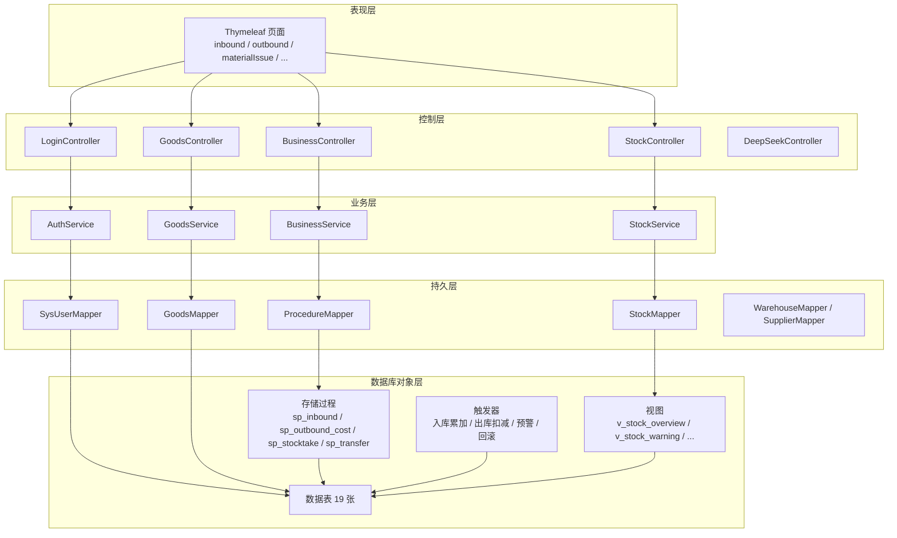
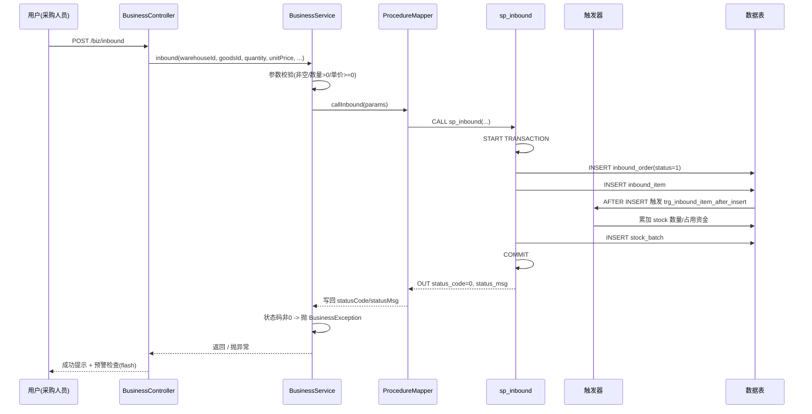
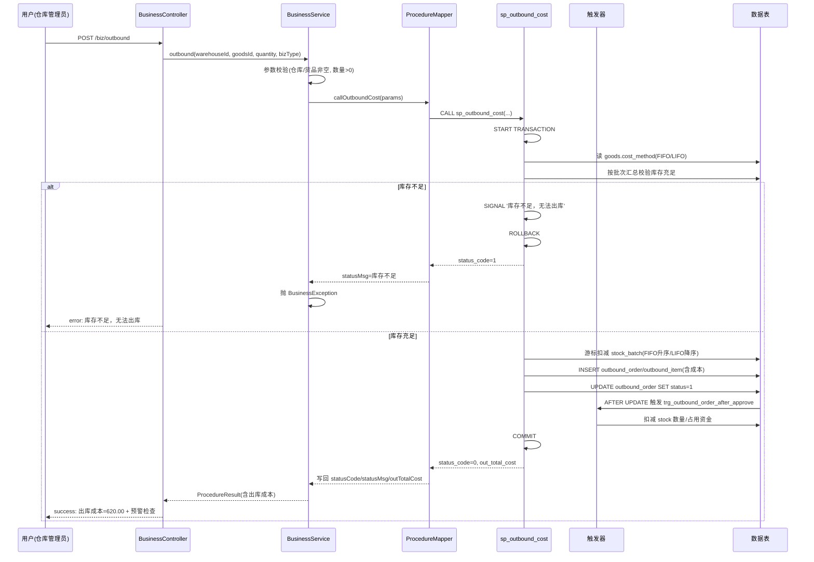
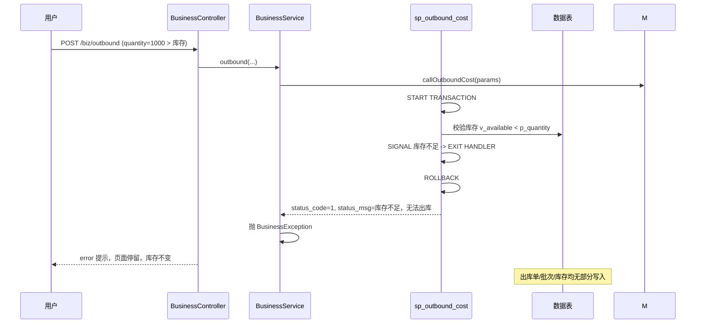

# 04-概要设计说明书

| 项目 | 内容 |
| --- | --- |
| 文档编号 | 04-概要设计 |
| 项目名称 | 仓库管理系统 |
| 负责成员 | 成员 B（系统设计师 / 后端开发工程师） |
| 版本 | V1.0 |
| 日期 | 2026-11-23 |
| 关联需求 | FR-02 采购入库、FR-03 销售/领料出库（本模块主责）；FR-01 权限、FR-04 盘点、FR-05 调拨、FR-06 查询预警（协作） |

---

## 1. 文档目的与范围

本文档将需求基线转换为可实现的系统设计，明确各模块（Controller / Service / Mapper / 数据库对象）的职责边界、核心业务（采购入库、销售/领料出库、库存不足异常）的数据流、事务边界与异常处理规则，作为后续编码与测试的依据。

**成员 B 的实现边界**（依据分工计划 4.3）：B 不直接修改库存表的最终更新规则；库存、批次、流水的一致性由成员 C 维护的数据库事务、存储过程、触发器与约束保证。B 负责正确调用存储过程、传参、处理返回状态，并把业务错误转为可理解的页面提示。

---

## 2. 总体架构

### 2.1 技术栈

| 层次 | 技术选型 |
| --- | --- |
| 表现层 | Thymeleaf 模板引擎 + HTML + CSS |
| 控制层 | Spring MVC（`@Controller` / `@RestController`） |
| 业务层 | Spring Service（`@Service`） |
| 持久层 | MyBatis（注解式 Mapper，`@MapperScan`） |
| 数据库 | MySQL 8.0（InnoDB） |

### 2.2 分层架构与核心设计理念

核心设计理念：**核心业务逻辑下沉到 MySQL**。入库、出库成本核算（FIFO/LIFO）、盘点、调拨的业务主体在数据库侧，由存储过程实现（含事务、异常回滚）；Java 层只做参数校验、业务组装、调用存储过程、读取 OUT 状态码与消息，不把成本算法写在 Java 代码里。

### 2.3 组件（模块）职责划分

| 模块 | 职责 | 关键类 / 对象 |
| --- | --- | --- |
| entity | 实体类，与表 / 视图字段一一对应 | Goods / Warehouse / Supplier / SysUser / StockView / StockAlert |
| config | MVC 配置，注册登录拦截器 | WebConfig |
| util | 异常、结果封装、拦截、AI 预留客户端 | BusinessException / ProcedureResult / AuthInterceptor / GlobalExceptionHandler / DeepSeekClient |
| mapper | 数据访问；ProcedureMapper 通过 CALLABLE 调用存储过程 | GoodsMapper / StockMapper / ProcedureMapper / SysUserMapper / WarehouseMapper / SupplierMapper |
| service | 参数校验、业务组装、调用存储过程并读取 OUT 状态 | BusinessService / GoodsService / AuthService / StockService |
| controller | 接收请求、组装 Model、跳转页面、返回提示 | LoginController / GoodsController / BusinessController / StockController / DeepSeekController |
| 数据库对象 | 事务、成本核算、库存联动、预警、统计查询 | 4 个存储过程 + 8 个触发器 + 4 个视图 |

### 2.4 职责边界（B 与 C 的分工）

| 事项 | 负责人 | 说明 |
| --- | --- | --- |
| 入库、出库业务代码（调用、传参、返回状态、错误提示） | B | BusinessService / BusinessController 的入库、出库、领料、退货路径 |
| 数据库事务、存储过程、触发器、约束（库存/批次/流水一致性） | C | sp_* 存储过程、trg_* 触发器、表约束 |
| 盘点、调拨业务代码 | C | BusinessService 中 stocktake / transfer 路径的最终一致性由 C 负责 |
| 权限拦截、角色校验 | A | AuthInterceptor 的登录拦截已存在，角色级鉴权由 A 补齐 |

### 2.5 密码安全设计（加密存储）

用户密码不落明文，采用 **SHA-256 + 随机盐** 方案，存储格式为 `salt:hash`（如 `salt01:f05341...ad8bfc`）：

- 新增用户时用 `PasswordUtil.encode()` 生成 `salt:hash` 密文入库；
- 登录校验用 `PasswordUtil.matches()` 对库中密文做 **常量时间比较**，避免时序攻击；
- 校验通过后立即清空内存中的密码散列，避免随 Session 长期驻留；
- 关闭 MyBatis `StdOutImpl` 标准输出日志，避免查询结果中的敏感字段（含密码散列）打印到控制台。

> 说明：登录接口仍以表单明文提交密码，传输层安全依赖后续 HTTPS 加固；本次范围仅覆盖「存储加密」。

---

## 3. 核心业务流程详细设计

### 3.1 采购入库（FR-02）

**输入**：入库仓库 `warehouseId`、货品 `goodsId`、入库数量 `quantity`、入库单价 `unitPrice`、供应商 `supplierId`（可空）、操作人 `operatorId`、业务类型 `bizType=PURCHASE`。

**处理**：

1. Service 层参数校验（仓库/货品非空、数量>0、单价非负）；
2. 组装参数调用存储过程 `sp_inbound`；
3. 存储过程校验数量、生成入库单号、插入入库单主表（status=1）；
4. 插入入库明细，**触发器 `trg_inbound_item_after_insert` 自动累加库存**；
5. 写入成本批次 `stock_batch`（供 FIFO/LIFO 出库核算）；
6. 提交事务，OUT 状态码写回；
7. Service 读取状态码，非 0 抛出 `BusinessException`；
8. Controller 捕获后转成页面 flash 提示，并检查库存预警。

**输出**：入库成功提示（含单号）或业务错误提示；库存数量与占用资金增加。

**异常分支**：数量 ≤0 → 「入库数量必须大于0」；参数为空 → 「入库仓库/货品不能为空」；外键非法 → 全局异常处理器提示。

### 3.2 销售 / 领料出库（FR-03，FIFO / LIFO 成本核算）

**输入**：出库仓库 `warehouseId`、货品 `goodsId`、出库数量 `quantity`、操作人 `operatorId`、业务类型 `bizType=SALE / MATERIAL_ISSUE`。

**处理**：

1. Service 层参数校验；
2. 调用存储过程 `sp_outbound_cost`；
3. 存储过程读取货品计价方式（FIFO/LIFO），按入库日期升序/降序游标遍历 `stock_batch` 扣减，累加出库成本；
4. 校验库存充足（不足则 SIGNAL 异常回滚）；
5. 生成出库单主表 + 明细（含 unit_cost/total_cost），审核通过（status=1）；
6. **触发器 `trg_outbound_order_after_approve` 自动扣减库存**；
7. 提交事务，OUT 状态码 + `out_total_cost` 写回；
8. Controller 把成本展示到页面。

**输出**：出库成功提示（含出库成本）、库存减少；或「库存不足，无法出库」。

**FIFO/LIFO 示例成本**（与测试数据一致，供 D 联调）：

| 场景 | 批次 | 出库 120 | 期望成本 |
| --- | --- | --- | --- |
| FIFO（G001） | 100@5、50@6 | 先进先出 | 100×5 + 20×6 = 620.00 |
| LIFO（G002） | 100@5、50@6 | 后进先出 | 50×6 + 70×5 = 650.00 |

### 3.3 库存不足异常处理（异常分支设计）

库存不足由存储过程 `sp_outbound_cost` 在事务内 `SIGNAL SQLSTATE '45000'` 触发 `EXIT HANDLER FOR SQLEXCEPTION` → `ROLLBACK`，此时**不产生出库单、不扣减批次、库存不变**，错误消息经 OUT 参数返回 Java 层，最终由 `BusinessException` 转为页面红色提示。

---

## 4. 异常码与错误处理设计

### 4.1 统一返回码约定（存储过程 OUT 参数）

| 状态码 | 含义 | 处理 |
| --- | --- | --- |
| 0 | 成功 | 正常返回结果，Controller 写入 `success` flash |
| 1 | 失败（已回滚） | Service 抛 `BusinessException`，Controller 写入 `error` flash |
| null | 调用异常 | 视为失败，提示「业务处理失败」 |

### 4.2 错误消息清单

| 来源 | 消息 | 触发场景 |
| --- | --- | --- |
| Service 校验 | 入库仓库 / 货品不能为空 | 未选择仓库 / 货品 |
| Service 校验 | 入库数量必须大于0 | 数量 ≤0 |
| Service 校验 | 入库单价不能为负 | 单价 <0 |
| Service 校验 | 出库仓库 / 货品不能为空 | 未选择仓库 / 货品 |
| Service 校验 | 出库数量必须大于0 | 数量 ≤0 |
| 存储过程 | 入库数量必须大于0 | sp_inbound |
| 存储过程 | 出库数量必须大于0 | sp_outbound_cost |
| 存储过程 | 库存不足，无法出库 | sp_outbound_cost |
| 存储过程 | 成本批次不足，出库核算失败 | sp_outbound_cost（理论分支，库存校验已前置拦截） |
| 存储过程 | 实盘数量不能为负 | sp_stocktake（C） |
| 存储过程 | 源仓库库存不足，无法调拨 | sp_transfer（C） |
| 存储过程 | 调出仓库与调入仓库不能相同 | sp_transfer（C） |
| 全局处理器 | 该数据已被其他业务数据引用… | 外键 / 数据完整性异常 |

### 4.3 异常传播链路

`存储过程 SIGNAL → EXIT HANDLER ROLLBACK → OUT status_code/status_msg → ProcedureMapper 写回 Map → BusinessService.checkResult 判非 0 抛 BusinessException → Controller catch → flash error → 页面展示`。

---

## 5. 事务边界

| 事务 | 范围 | 回滚保证 |
| --- | --- | --- |
| sp_inbound | 入库单 + 明细 + 成本批次 +（触发器累加库存） | SQLEXCEPTION 整体回滚，无部分写入 |
| sp_outbound_cost | 批次扣减 + 出库单 + 明细 + 审核扣库存（触发器） | 库存不足/批次不足整体回滚 |
| sp_stocktake | 盘点单 + 明细 + 库存修正 | 负数实盘被拒绝（C） |
| sp_transfer | 调拨单 + 明细 + 源减目标增 | 任一明细失败整体回滚（C） |

> 说明：入库累加库存、出库扣减库存由**触发器**在明细/审核时自动完成，与存储过程在同一事务内，随事务回滚而撤销，因此不会出现「单据写入但库存未联动」的部分写入。

---

## 6. 模块间接口依赖

| 依赖方 | 提供方 | 接口 / 契约 |
| --- | --- | --- |
| B（后端） | A（权限） | 登录拦截规则、Session 中 `loginUser`、角色权限边界 |
| B（后端） | C（数据库） | 4 个存储过程入参 / 出参 / 返回码、触发器联动规则 |
| D（前端） | B（后端） | 页面接口、参数、成功/异常示例（见 `05-接口与异常说明.md`） |

---

## 7. 对后续阶段的要求

1. 成员 C 应保证 `sp_inbound` / `sp_outbound_cost` 的入参、出参、返回码与本设计 4.1/4.2 一致，变更需同步通知 B；
2. 成员 D 应依据 `05-接口与异常说明.md` 编写正常、库存不足、错误参数三类用例；
3. 成员 A 完成角色权限改造后，入库/出库接口应在权限校验之后才进入业务逻辑。

---

## 8. BUG-B-001 密码安全修复设计闭环

本节是本轮概要设计的补充，不单独新建缺陷文档。原因是该问题同时影响认证模块职责、接口约定和代码评审结论，分别在本设计、第 5 号接口说明和 B-05 评审记录中闭环更便于追踪。

| 项目 | 设计与实现结论 |
| --- | --- |
| 原问题 | `AuthService` 直接比较数据库密码字段，MyBatis `StdOutImpl` 可能将含密码字段的查询结果写入控制台；测试种子数据也存在明文密码。 |
| 存储方案 | 密码统一存为 `salt:hash`；`salt` 为随机 16 字节十六进制值，`hash = SHA-256(salt + 明文密码)`。 |
| 校验方案 | `PasswordUtil.matches()` 解析已存散列并使用常量时间比较；认证成功后清空会话用户对象中的密码字段。 |
| 写入边界 | 新增用户、修改了非空密码的用户均由 `SysUserController` 编码后写入；未提交新密码时保留既有散列。 |
| 日志边界 | 移除 MyBatis `StdOutImpl`，不在标准输出中记录查询参数或结果列。 |
| 数据迁移 | `05_test_and_verify.sql` 与 `08-rbac-lab.sql` 的演示账号均生成加盐散列。 |

**冻结实现版本：**`main` / `f567731dc08f1869692cb9119dd417446c712f71`。D 的复测确认：系统用户与 RBAC 账号均符合散列格式、认证与用户维护功能正常、运行日志未出现 MyBatis 标准输出。详细复测记录见 `docs/D/09-测试报告.md`。
