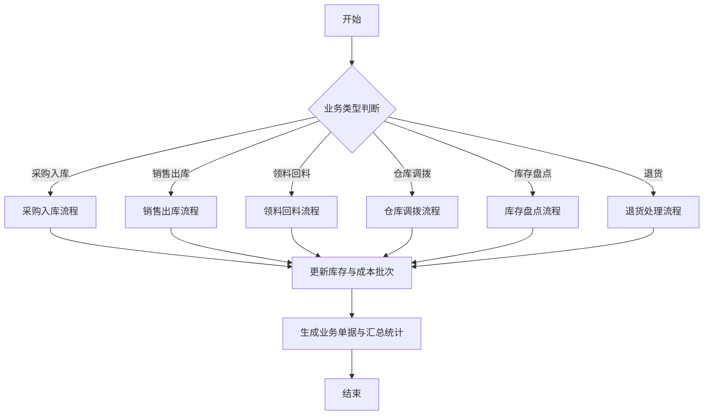
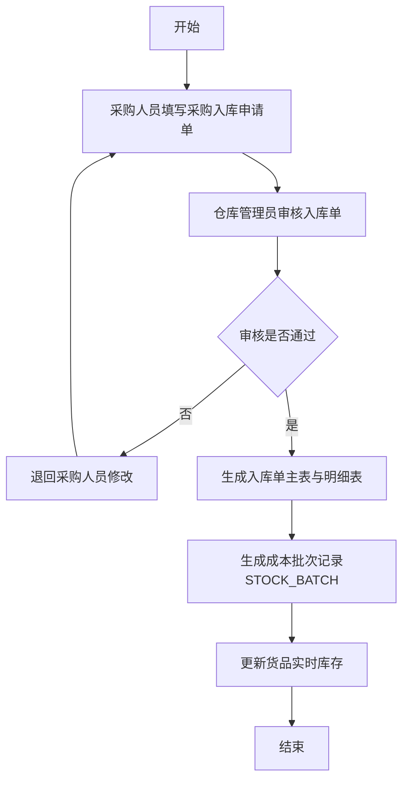
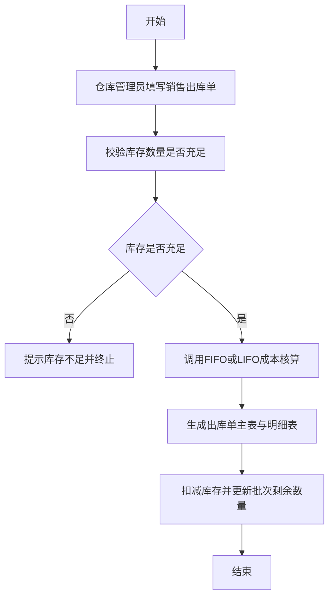
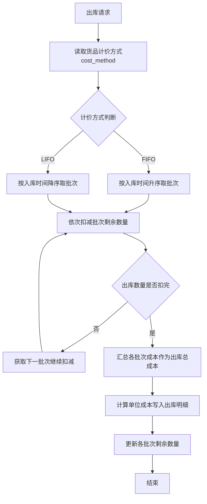
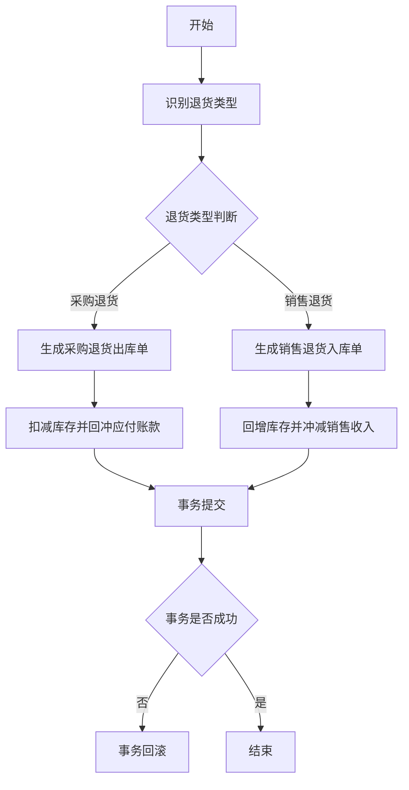
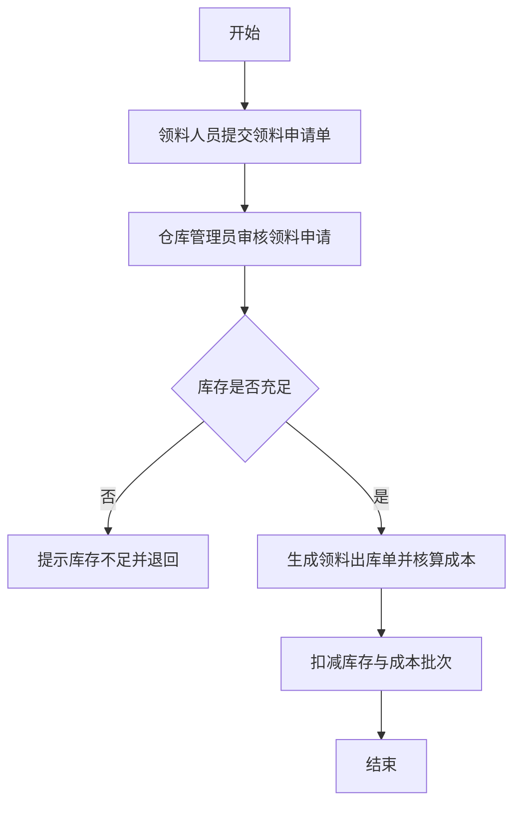
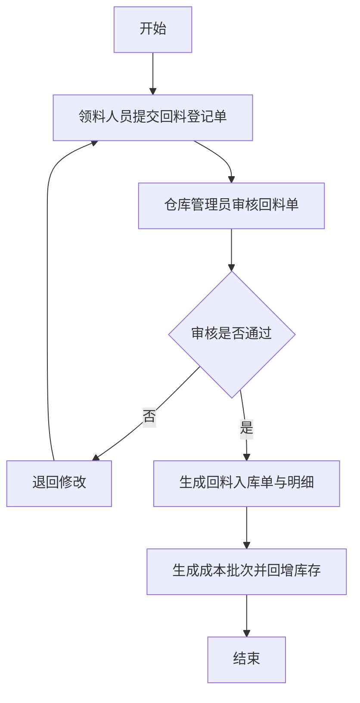
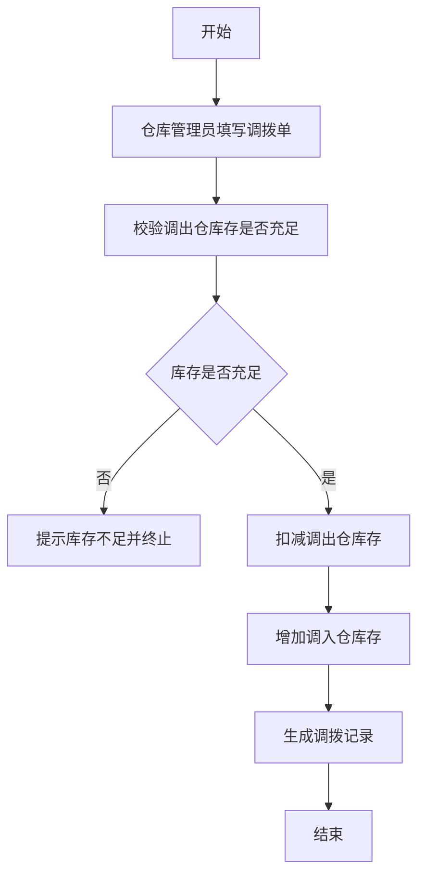
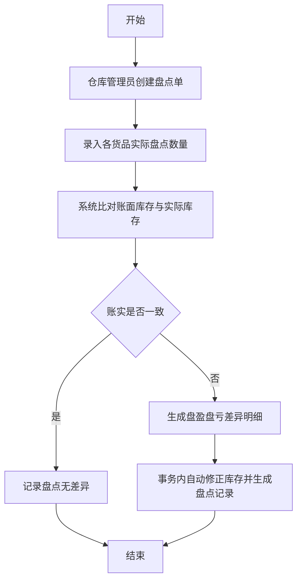
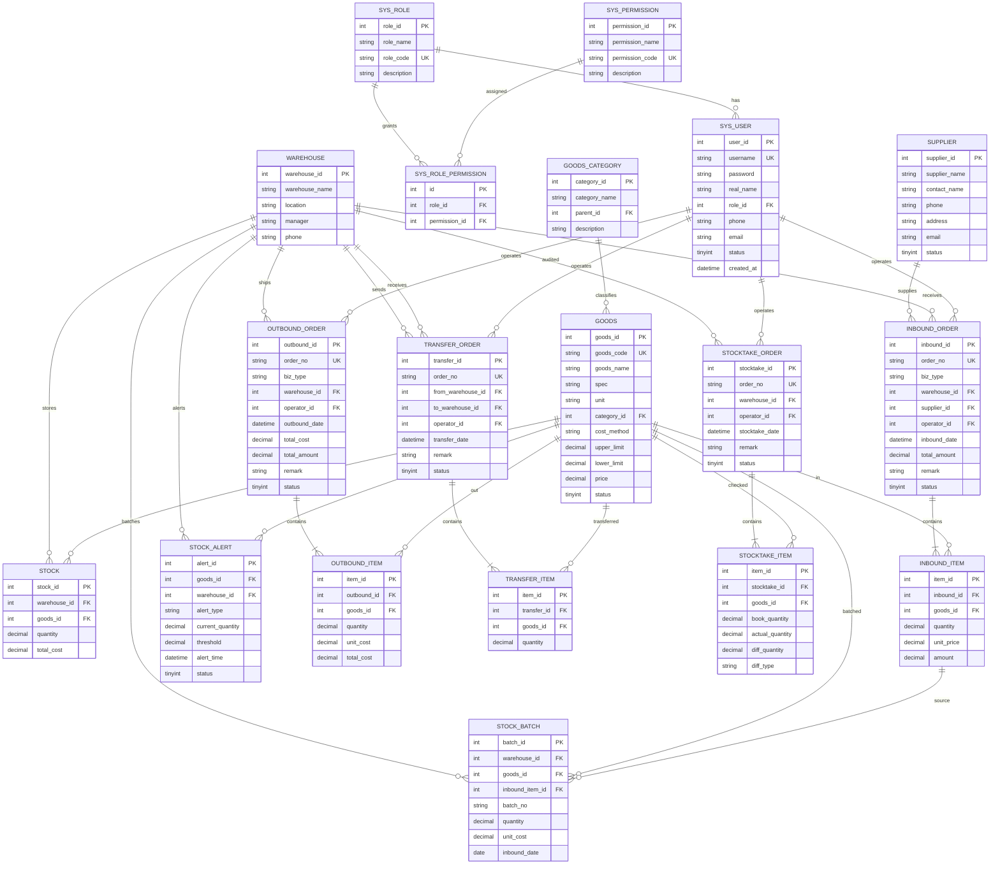

# 仓库管理系统业务流程与 ER 图设计

> 文档定位：原项目继承的概念设计基线，现由成员 C 维护。当前可执行数据库结构以 `code/sql/` 为准；RBAC、密码安全和接口参数校验等改造以 A、B 的最终文档为准。

| 项目 | 内容 |
| --- | --- |
| 课程名称 | 数据库系统课程设计 |
| 题目 | 仓库管理系统 |
| 阶段 | 阶段二：业务流程梳理与概念结构设计（ER 图） |
| 技术栈 | Java + MySQL 8.0 |
| 文档说明 | 本文档可直接粘贴进课程设计报告第五章“数据库概念设计”及第一次答辩 ER 图讲解 |

> 说明：本设计中的 ER 图严格使用 Mermaid 标准 `erDiagram` 语法，实体名称与属性名全部采用英文（符合课程绘图规范）；业务流程图使用标准 `flowchart` 语法。所有说明文字均置于代码块之外。

---

## 一、系统总体业务流程

系统以仓储单据流转为主线，覆盖采购、销售、领料、调拨、盘点、退货等业务，所有业务最终统一联动库存与批次，形成账实一致的闭环。

---

## 二、核心业务流程图

### 2.1 采购入库流程

**说明**：采购入库审核通过后，系统生成入库单主表与明细，同时按入库单价写入成本批次表（STOCK_BATCH），并累加库存数量，为后续 FIFO/LIFO 出库成本核算提供依据。

### 2.2 销售出库流程

**说明**：销售出库前先校验库存，充足时按货品计价方式调用 FIFO/LIFO 成本核算，将计算出的单位成本写入出库明细，随后扣减库存与批次剩余数量。

### 2.3 FIFO/LIFO 出库成本核算流程

**说明**：成本核算读取货品的计价方式字段，FIFO 按入库时间升序、LIFO 按降序依次消耗成本批次，直至出库数量扣减完毕，汇总各批次成本得到本次出库成本。

### 2.4 退货处理流程

**说明**：退货按类型分别生成采购退货出库单或销售退货入库单，联动库存与往来账目，全程在事务中执行，提交失败自动回滚。

### 2.5 领料流程

### 2.6 回料流程

### 2.7 仓库调拨流程

### 2.8 库存盘点流程

---

## 三、业务实体抽象

### 3.1 实体清单与职责

按功能划分为六大模块，共 19 张业务表：

| 模块 | 实体表 | 职责 |
| --- | --- | --- |
| 系统权限 | SYS_USER、SYS_ROLE、SYS_PERMISSION、SYS_ROLE_PERMISSION | 用户、角色、权限及角色-权限多对多关系 |
| 基础资料 | GOODS_CATEGORY、SUPPLIER、WAREHOUSE、GOODS | 货品分类、供应商、仓库、货品基础信息（含上下限阈值与计价方式） |
| 库存台账 | STOCK、STOCK_BATCH | 实时库存数量、成本批次（支撑 FIFO/LIFO） |
| 出入库单据 | INBOUND_ORDER、INBOUND_ITEM、OUTBOUND_ORDER、OUTBOUND_ITEM | 入库/出库单主表与明细（承载采购、销售、退货、领料、回料、盘点、调拨） |
| 业务单据 | TRANSFER_ORDER、TRANSFER_ITEM、STOCKTAKE_ORDER、STOCKTAKE_ITEM | 调拨单、盘点单主表与明细 |
| 库存预警 | STOCK_ALERT | 库存超储/短缺预警记录 |

### 3.2 实体属性设计

#### 3.2.1 SYS_USER（用户表）

| 字段名 | 数据类型 | 键 | 说明 |
| --- | --- | --- | --- |
| user_id | INT | PK | 用户编号 |
| username | VARCHAR(50) | UK | 登录账号 |
| password | VARCHAR(100) |  | 加密密码 |
| real_name | VARCHAR(50) |  | 真实姓名 |
| role_id | INT | FK | 所属角色 |
| phone | VARCHAR(20) |  | 联系电话 |
| email | VARCHAR(100) |  | 邮箱 |
| status | TINYINT |  | 状态（1 启用 0 禁用） |
| created_at | DATETIME |  | 创建时间 |

#### 3.2.2 SYS_ROLE（角色表）

| 字段名 | 数据类型 | 键 | 说明 |
| --- | --- | --- | --- |
| role_id | INT | PK | 角色编号 |
| role_name | VARCHAR(50) |  | 角色名称 |
| role_code | VARCHAR(50) | UK | 角色编码 |
| description | VARCHAR(255) |  | 角色描述 |

#### 3.2.3 SYS_PERMISSION（权限表）

| 字段名 | 数据类型 | 键 | 说明 |
| --- | --- | --- | --- |
| permission_id | INT | PK | 权限编号 |
| permission_name | VARCHAR(50) |  | 权限名称 |
| permission_code | VARCHAR(100) | UK | 权限编码 |
| description | VARCHAR(255) |  | 权限描述 |

#### 3.2.4 SYS_ROLE_PERMISSION（角色权限中间表）

| 字段名 | 数据类型 | 键 | 说明 |
| --- | --- | --- | --- |
| id | INT | PK | 主键 |
| role_id | INT | FK | 角色编号 |
| permission_id | INT | FK | 权限编号 |

#### 3.2.5 GOODS_CATEGORY（货品分类表）

| 字段名 | 数据类型 | 键 | 说明 |
| --- | --- | --- | --- |
| category_id | INT | PK | 分类编号 |
| category_name | VARCHAR(50) |  | 分类名称 |
| parent_id | INT | FK | 上级分类编号（自关联） |
| description | VARCHAR(255) |  | 分类描述 |

#### 3.2.6 SUPPLIER（供应商表）

| 字段名 | 数据类型 | 键 | 说明 |
| --- | --- | --- | --- |
| supplier_id | INT | PK | 供应商编号 |
| supplier_name | VARCHAR(100) |  | 供应商名称 |
| contact_name | VARCHAR(50) |  | 联系人 |
| phone | VARCHAR(20) |  | 联系电话 |
| address | VARCHAR(255) |  | 联系地址 |
| email | VARCHAR(100) |  | 邮箱 |
| status | TINYINT |  | 状态 |

#### 3.2.7 WAREHOUSE（仓库表）

| 字段名 | 数据类型 | 键 | 说明 |
| --- | --- | --- | --- |
| warehouse_id | INT | PK | 仓库编号 |
| warehouse_name | VARCHAR(100) |  | 仓库名称 |
| location | VARCHAR(255) |  | 仓库位置 |
| manager | VARCHAR(50) |  | 负责人 |
| phone | VARCHAR(20) |  | 联系电话 |

#### 3.2.8 GOODS（货品基础信息表）

| 字段名 | 数据类型 | 键 | 说明 |
| --- | --- | --- | --- |
| goods_id | INT | PK | 货品编号 |
| goods_code | VARCHAR(50) | UK | 货品编码 |
| goods_name | VARCHAR(100) |  | 货品名称 |
| spec | VARCHAR(100) |  | 规格型号 |
| unit | VARCHAR(20) |  | 计量单位 |
| category_id | INT | FK | 所属分类 |
| cost_method | VARCHAR(10) |  | 计价方式（FIFO/LIFO） |
| upper_limit | DECIMAL(12,2) |  | 库存上限阈值 |
| lower_limit | DECIMAL(12,2) |  | 库存下限阈值 |
| price | DECIMAL(12,2) |  | 参考售价 |
| status | TINYINT |  | 状态 |

#### 3.2.9 STOCK（库存表）

| 字段名 | 数据类型 | 键 | 说明 |
| --- | --- | --- | --- |
| stock_id | INT | PK | 库存编号 |
| warehouse_id | INT | FK | 仓库编号 |
| goods_id | INT | FK | 货品编号 |
| quantity | DECIMAL(12,2) |  | 当前库存数量 |
| total_cost | DECIMAL(12,2) |  | 库存占用资金 |

#### 3.2.10 STOCK_BATCH（成本批次表）

| 字段名 | 数据类型 | 键 | 说明 |
| --- | --- | --- | --- |
| batch_id | INT | PK | 批次编号 |
| warehouse_id | INT | FK | 仓库编号 |
| goods_id | INT | FK | 货品编号 |
| inbound_item_id | INT | FK | 来源入库明细 |
| batch_no | VARCHAR(50) |  | 批次号 |
| quantity | DECIMAL(12,2) |  | 批次剩余数量 |
| unit_cost | DECIMAL(12,2) |  | 批次单位成本 |
| inbound_date | DATE |  | 入库日期 |

#### 3.2.11 INBOUND_ORDER（入库单主表）

| 字段名 | 数据类型 | 键 | 说明 |
| --- | --- | --- | --- |
| inbound_id | INT | PK | 入库单编号 |
| order_no | VARCHAR(50) | UK | 单据编号 |
| biz_type | VARCHAR(20) |  | 业务类型（采购入库/销售退货/回料/盘盈/调拨入） |
| warehouse_id | INT | FK | 入库仓库 |
| supplier_id | INT | FK | 供应商（采购入库） |
| operator_id | INT | FK | 操作人 |
| inbound_date | DATETIME |  | 入库日期 |
| total_amount | DECIMAL(12,2) |  | 入库总金额 |
| remark | VARCHAR(255) |  | 备注 |
| status | TINYINT |  | 单据状态 |

#### 3.2.12 INBOUND_ITEM（入库明细表）

| 字段名 | 数据类型 | 键 | 说明 |
| --- | --- | --- | --- |
| item_id | INT | PK | 明细编号 |
| inbound_id | INT | FK | 入库单编号 |
| goods_id | INT | FK | 货品编号 |
| quantity | DECIMAL(12,2) |  | 入库数量 |
| unit_price | DECIMAL(12,2) |  | 入库单价 |
| amount | DECIMAL(12,2) |  | 金额 |

#### 3.2.13 OUTBOUND_ORDER（出库单主表）

| 字段名 | 数据类型 | 键 | 说明 |
| --- | --- | --- | --- |
| outbound_id | INT | PK | 出库单编号 |
| order_no | VARCHAR(50) | UK | 单据编号 |
| biz_type | VARCHAR(20) |  | 业务类型（销售出库/领料/采购退货/盘亏/调拨出） |
| warehouse_id | INT | FK | 出库仓库 |
| operator_id | INT | FK | 操作人 |
| outbound_date | DATETIME |  | 出库日期 |
| total_cost | DECIMAL(12,2) |  | 出库总成本 |
| total_amount | DECIMAL(12,2) |  | 出库总金额 |
| remark | VARCHAR(255) |  | 备注 |
| status | TINYINT |  | 单据状态 |

#### 3.2.14 OUTBOUND_ITEM（出库明细表）

| 字段名 | 数据类型 | 键 | 说明 |
| --- | --- | --- | --- |
| item_id | INT | PK | 明细编号 |
| outbound_id | INT | FK | 出库单编号 |
| goods_id | INT | FK | 货品编号 |
| quantity | DECIMAL(12,2) |  | 出库数量 |
| unit_cost | DECIMAL(12,2) |  | 单位成本（FIFO/LIFO 计算） |
| total_cost | DECIMAL(12,2) |  | 成本金额 |

#### 3.2.15 TRANSFER_ORDER（调拨单主表）

| 字段名 | 数据类型 | 键 | 说明 |
| --- | --- | --- | --- |
| transfer_id | INT | PK | 调拨单编号 |
| order_no | VARCHAR(50) | UK | 单据编号 |
| from_warehouse_id | INT | FK | 调出仓库 |
| to_warehouse_id | INT | FK | 调入仓库 |
| operator_id | INT | FK | 操作人 |
| transfer_date | DATETIME |  | 调拨日期 |
| remark | VARCHAR(255) |  | 备注 |
| status | TINYINT |  | 单据状态 |

#### 3.2.16 TRANSFER_ITEM（调拨明细表）

| 字段名 | 数据类型 | 键 | 说明 |
| --- | --- | --- | --- |
| item_id | INT | PK | 明细编号 |
| transfer_id | INT | FK | 调拨单编号 |
| goods_id | INT | FK | 货品编号 |
| quantity | DECIMAL(12,2) |  | 调拨数量 |

#### 3.2.17 STOCKTAKE_ORDER（盘点单主表）

| 字段名 | 数据类型 | 键 | 说明 |
| --- | --- | --- | --- |
| stocktake_id | INT | PK | 盘点单编号 |
| order_no | VARCHAR(50) | UK | 单据编号 |
| warehouse_id | INT | FK | 盘点仓库 |
| operator_id | INT | FK | 操作人 |
| stocktake_date | DATETIME |  | 盘点日期 |
| remark | VARCHAR(255) |  | 备注 |
| status | TINYINT |  | 单据状态 |

#### 3.2.18 STOCKTAKE_ITEM（盘点明细表）

| 字段名 | 数据类型 | 键 | 说明 |
| --- | --- | --- | --- |
| item_id | INT | PK | 明细编号 |
| stocktake_id | INT | FK | 盘点单编号 |
| goods_id | INT | FK | 货品编号 |
| book_quantity | DECIMAL(12,2) |  | 账面数量 |
| actual_quantity | DECIMAL(12,2) |  | 实盘数量 |
| diff_quantity | DECIMAL(12,2) |  | 差异数量 |
| diff_type | VARCHAR(10) |  | 差异类型（盘盈/盘亏/无差异） |

#### 3.2.19 STOCK_ALERT（库存预警记录表）

| 字段名 | 数据类型 | 键 | 说明 |
| --- | --- | --- | --- |
| alert_id | INT | PK | 预警编号 |
| goods_id | INT | FK | 货品编号 |
| warehouse_id | INT | FK | 仓库编号 |
| alert_type | VARCHAR(10) |  | 预警类型（超储/短缺） |
| current_quantity | DECIMAL(12,2) |  | 当前库存数量 |
| threshold | DECIMAL(12,2) |  | 触发阈值 |
| alert_time | DATETIME |  | 预警时间 |
| status | TINYINT |  | 处理状态 |

---

## 四、ER 图（Mermaid erDiagram）

### 4.1 完整 ER 图

实体名称与属性名均采用英文，关系连线使用标准 Mermaid `erDiagram` 基数表示法：`||--o{`（一对多，右侧零或多）、`||--|{`（一对多，右侧一或多）。

### 4.2 ER 图说明

1. 本 ER 图共包含 19 个实体，实体名与属性名全部采用英文，符合课程绘图规范。
2. 关系连线使用 `erDiagram` 标准基数表示：`||--o{` 表示“一”方与“零或多”方，`||--|{` 表示“一”方与“一或多”方（用于主表-明细表关系）。
3. 货品分类表 `GOODS_CATEGORY` 存在自关联（`parent_id` 指向自身），用于表示多级分类树，此自关联在属性中体现，未在图中绘制自环连线以避免渲染歧义。

---

## 五、实体间关联关系说明

### 5.1 一对多关系（1:N）

| 关系 | 一方 | 多方 | 说明 |
| --- | --- | --- | --- |
| 角色-用户 | SYS_ROLE | SYS_USER | 一个角色对应多个用户 |
| 分类-货品 | GOODS_CATEGORY | GOODS | 一个分类包含多个货品 |
| 供应商-入库单 | SUPPLIER | INBOUND_ORDER | 一个供应商对应多张入库单 |
| 仓库-库存 | WAREHOUSE | STOCK | 一个仓库对应多条库存记录 |
| 货品-库存 | GOODS | STOCK | 一个货品对应多条库存记录 |
| 货品-批次 | GOODS | STOCK_BATCH | 一个货品对应多个成本批次 |
| 入库单-入库明细 | INBOUND_ORDER | INBOUND_ITEM | 一张入库单含多条明细 |
| 出库单-出库明细 | OUTBOUND_ORDER | OUTBOUND_ITEM | 一张出库单含多条明细 |
| 调拨单-调拨明细 | TRANSFER_ORDER | TRANSFER_ITEM | 一张调拨单含多条明细 |
| 盘点单-盘点明细 | STOCKTAKE_ORDER | STOCKTAKE_ITEM | 一张盘点单含多条明细 |
| 用户-单据 | SYS_USER | 各类单据 | 一个操作人经办多张单据 |

### 5.2 多对多关系（M:N，已拆分中间表）

| 关系 | 实体A | 实体B | 中间表 | 说明 |
| --- | --- | --- | --- | --- |
| 角色-权限 | SYS_ROLE | SYS_PERMISSION | SYS_ROLE_PERMISSION | 一个角色拥有多个权限，一个权限可分配给多个角色 |

### 5.3 仓库调拨的双重关联

`TRANSFER_ORDER` 同时通过 `from_warehouse_id`、`to_warehouse_id` 关联 `WAREHOUSE`，分别表示“调出仓库”与“调入仓库”，在 ER 图中以两条关系线 `sends` 与 `receives` 表示。

---

## 六、第三范式（3NF）设计说明

### 6.1 第一范式（1NF）

所有表字段均为原子值，不存在重复组或多值字段。出入库、调拨、盘点单据均采用“主表 + 明细表”拆分，避免在同一行中存储多货品明细。

### 6.2 第二范式（2NF）

各表均以单一主键标识，不存在复合主键导致的部分函数依赖。明细表主键为 `item_id`，非主键属性（数量、单价、金额）完全依赖于主键，不依赖主键的一部分。

### 6.3 第三范式（3NF）

各表消除传递依赖，非主键属性仅直接依赖于主键。典型体现：

1. **供应商信息独立存放**：入库单主表仅存 `supplier_id`，供应商名称、联系方式等存于 `SUPPLIER` 表，避免入库单表冗余供应商属性。
2. **货品信息独立存放**：明细表仅存 `goods_id`，货品名称、规格、单位、计价方式等存于 `GOODS` 表。
3. **仓库信息独立存放**：库存、单据表仅存 `warehouse_id`，仓库名称、位置等存于 `WAREHOUSE` 表。
4. **成本批次独立存放**：出库明细存计算结果 `unit_cost`，而批次剩余数量与单价存于 `STOCK_BATCH`，避免出库明细与入库明细互相传递依赖。

### 6.4 范式验证总结

| 潜在冗余/依赖问题 | 本设计的处理方式 |
| --- | --- |
| 单据表冗余供应商名称 | 供应商信息独立成 SUPPLIER 表 |
| 明细表冗余货品名称/单位 | 货品信息独立成 GOODS 表 |
| 单据表冗余仓库名称/位置 | 仓库信息独立成 WAREHOUSE 表 |
| 出库成本无法追溯来源 | 成本批次独立成 STOCK_BATCH 表 |
| 角色权限直接多对多 | 拆分为 SYS_ROLE_PERMISSION 中间表 |

经逐项检查，全部 19 张表均满足第三范式，不存在部分依赖与传递依赖。

---

## 七、库存预警与 FIFO/LIFO 成本核算在 ER 层的落地

### 7.1 库存上下限预警的 ER 落地

1. **阈值存储**：`GOODS` 表通过 `upper_limit`、`lower_limit` 字段存储货品库存上、下限阈值。
2. **实时数量**：`STOCK` 表按 `warehouse_id + goods_id` 维度存储当前库存数量 `quantity`。
3. **预警记录**：`STOCK_ALERT` 表存储触发的预警记录，通过 `alert_type` 区分“超储/短缺”。该表由触发器在库存变动时自动写入：当 `STOCK.quantity < GOODS.lower_limit` 记为短缺，当 `STOCK.quantity > GOODS.upper_limit` 记为超储。

### 7.2 FIFO/LIFO 成本核算的 ER 落地

1. **计价方式标识**：`GOODS.cost_method` 字段标记货品采用 FIFO 还是 LIFO。
2. **成本批次台账**：`STOCK_BATCH` 表按“仓库 + 货品 + 入库批次”记录每批剩余数量 `quantity` 与单位成本 `unit_cost`，并以 `inbound_date` 作为批次先后顺序依据。
3. **出库成本计算**：出库时依据 `cost_method` 选择批次扣减顺序——FIFO 按 `inbound_date` 升序先扣最早批次，LIFO 按 `inbound_date` 降序先扣最新批次，逐批扣减至出库数量扣完，汇总各批次成本得到出库总成本，写入 `OUTBOUND_ITEM.unit_cost`。

---

## 八、业务表数量与核心业务覆盖核对

| 核心业务 | 承载表 | 落地机制 |
| --- | --- | --- |
| 采购入库 | INBOUND_ORDER + INBOUND_ITEM | biz_type = 采购入库，入库存储过程 |
| 销售出库 | OUTBOUND_ORDER + OUTBOUND_ITEM | biz_type = 销售出库，出库存储过程 |
| 退货 | INBOUND_ORDER / OUTBOUND_ORDER | biz_type = 采购退货 / 销售退货，事务处理 |
| 领料 | OUTBOUND_ORDER + OUTBOUND_ITEM | biz_type = 领料出库 |
| 回料 | INBOUND_ORDER + INBOUND_ITEM | biz_type = 回料入库 |
| 仓库调拨 | TRANSFER_ORDER + TRANSFER_ITEM | 调拨存储过程 |
| 库存盘点 | STOCKTAKE_ORDER + STOCKTAKE_ITEM | 盘点存储过程，盘盈盘亏 |
| FIFO/LIFO 成本核算 | GOODS + STOCK_BATCH + OUTBOUND_ITEM | 成本核算存储过程 |

**结论**：本设计共 19 张业务表，大于课程要求的至少 9 张；覆盖采购入库、销售出库、退货、领料、回料、仓库调拨、库存盘点、FIFO/LIFO 出库成本核算全部核心业务，满足课程硬性约束。
