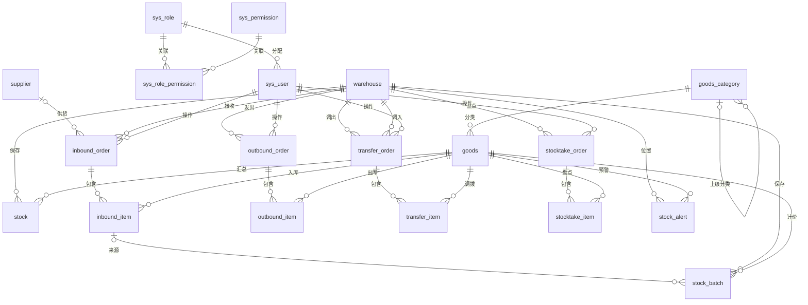

# 06 数据库设计

> 本文是 C 的数据库设计总览。完整业务流程与 ER 图见 `02-业务流程与ER图设计.md`，完整表结构见 `03-MySQL数据表设计.md`，视图、触发器、存储过程与事务设计见 `04-数据库对象与事务设计.md`；可执行脚本以 `code/sql/` 为唯一版本。

本设计对应仓库管理系统 C 部分，基于项目压缩包的 InnoDB 数据模型。初始连接使用独立的 `warehouse_db` 实验库，SQL 执行方法见 README。

## ER 图

## 库存事务与对象职责

| 需求 | 入口 | 持久化规则与异常行为 |
|---|---|---|
| FR-02 入库 | `sp_inbound` | 写入主单与明细，明细触发器增加库存，过程新增成本批次。非法数量、负单价或任一写入失败时回滚。 |
| FR-03 出库 | `sp_outbound_cost` | 锁定该仓该货的库存行，检查账面及可用批次数量，按 FIFO/LIFO 扣批次。生成出库单后通过审核触发器扣账面库存。返回核算成本。 |
| FR-04 盘点 | `sp_stocktake` | 校验实盘数量，锁定已有库存行，记录账面与实盘差额。盘盈以当前平均单位成本新增批次，原库存为零时使用货品参考售价。盘亏按货品计价顺序扣批次。盘点单、批次、库存与预警相关写入处于同一事务。 |
| FR-05 调拨 | `sp_transfer` | 按 JSON 明细顺序核对源库存并扣批次，将扣出的数量、单位成本、入库日期和来源复制为目标仓批次。源减目标增与主单、明细同属一笔事务。任何明细失败都会回滚。 |
| FR-06 预警 | `v_stock_warning`、库存触发器 | 实时视图以当前数量和货品阈值判定。预警记录存储写入时的数量和阈值，供历史审计。 |

`sp_consume_stock_batches` 由盘点和调拨在各自事务中调用。批次按入库日期、批次编号排序，同日调入的目标仓批次以目标仓新增编号排序。允许同一入库明细对应多个批次片段。盘盈批次的来源入库明细为空，通过盘点单号关联。每批次记录剩余成本。扣批次时按扣减数量占剩余数量的比例分摊到分，取完本批时分摊全部尾差。调拨双方使用同一笔分摊金额。过程捕获 SQL 异常后回滚，返回状态码 1，成功返回 0。遇到并发死锁时由失败方在业务层决定是否重试整笔操作。

`stock` 通过仓库 ID 和货品 ID 的唯一键维护汇总库存。`v_inout_summary` 从入库和出库明细形成流水视图。盘点和调拨记录在各自单据表。直接修改业务单据或批次可能绕过存储过程中的联动逻辑，常规操作应使用业务入口。

## 验证追踪

| 需求 | 回归脚本中的用例 | 一致性校验 |
|---|---|---|
| FR-02 | C02、C03、C14、C15 | 入库单金额、入库流水、库存与批次 |
| FR-03 | C01、C04、C07、C09、C16、C17 | 出库成本、出库流水、库存与批次 |
| FR-04 | C05、C07、C10、C11 | 实盘差额与类型、库存与批次 |
| FR-05 | C06 至 C09、C18 | 两端库存数量和成本、相关单据与批次 |
| FR-06 | C12、C13 | 预警事件数量与阈值 |

参考压缩包原设计见本目录下的 `reference/`。以下数据字典按本版建表脚本整理。

## 数据字典

### `sys_role` · 角色表

| 字段 | 定义 | 含义 |
|---|---|---|
| `role_id` | `INT UNSIGNED NOT NULL AUTO_INCREMENT` | 角色编号 |
| `role_name` | `VARCHAR(50) NOT NULL` | 角色名称 |
| `role_code` | `VARCHAR(50) NOT NULL` | 角色编码 |
| `description` | `VARCHAR(255) DEFAULT NULL` | 角色描述 |

- `PRIMARY KEY (role_id)`
- `UNIQUE KEY uk_role_code (role_code)`

### `sys_permission` · 权限表

| 字段 | 定义 | 含义 |
|---|---|---|
| `permission_id` | `INT UNSIGNED NOT NULL AUTO_INCREMENT` | 权限编号 |
| `permission_name` | `VARCHAR(50) NOT NULL` | 权限名称 |
| `permission_code` | `VARCHAR(100) NOT NULL` | 权限编码 |
| `description` | `VARCHAR(255) DEFAULT NULL` | 权限描述 |

- `PRIMARY KEY (permission_id)`
- `UNIQUE KEY uk_permission_code (permission_code)`

### `sys_role_permission` · 角色权限中间表

| 字段 | 定义 | 含义 |
|---|---|---|
| `id` | `INT UNSIGNED NOT NULL AUTO_INCREMENT` | 主键 |
| `role_id` | `INT UNSIGNED NOT NULL` | 角色编号 |
| `permission_id` | `INT UNSIGNED NOT NULL` | 权限编号 |

- `PRIMARY KEY (id)`
- `UNIQUE KEY uk_role_permission (role_id, permission_id)`
- `KEY idx_role_id (role_id)`
- `KEY idx_permission_id (permission_id)`
- `CONSTRAINT fk_rp_role FOREIGN KEY (role_id) REFERENCES sys_role (role_id) ON DELETE CASCADE ON UPDATE CASCADE`
- `CONSTRAINT fk_rp_permission FOREIGN KEY (permission_id) REFERENCES sys_permission (permission_id) ON DELETE CASCADE ON UPDATE CASCADE`

### `sys_user` · 用户表

| 字段 | 定义 | 含义 |
|---|---|---|
| `user_id` | `INT UNSIGNED NOT NULL AUTO_INCREMENT` | 用户编号 |
| `username` | `VARCHAR(50) NOT NULL` | 登录账号 |
| `password` | `VARCHAR(100) NOT NULL` | 加密密码 |
| `real_name` | `VARCHAR(50) NOT NULL` | 真实姓名 |
| `role_id` | `INT UNSIGNED NOT NULL` | 所属角色编号 |
| `phone` | `VARCHAR(20) DEFAULT NULL` | 联系电话 |
| `email` | `VARCHAR(100) DEFAULT NULL` | 邮箱 |
| `status` | `TINYINT NOT NULL DEFAULT 1` | 状态(1启用 0禁用) |
| `created_at` | `DATETIME NOT NULL DEFAULT CURRENT_TIMESTAMP` | 创建时间 |

- `PRIMARY KEY (user_id)`
- `UNIQUE KEY uk_username (username)`
- `KEY idx_role_id (role_id)`
- `CONSTRAINT fk_user_role FOREIGN KEY (role_id) REFERENCES sys_role (role_id) ON DELETE RESTRICT ON UPDATE CASCADE`

### `goods_category` · 货品分类表

| 字段 | 定义 | 含义 |
|---|---|---|
| `category_id` | `INT UNSIGNED NOT NULL AUTO_INCREMENT` | 分类编号 |
| `category_name` | `VARCHAR(50) NOT NULL` | 分类名称 |
| `parent_id` | `INT UNSIGNED DEFAULT NULL` | 上级分类编号(自关联) |
| `description` | `VARCHAR(255) DEFAULT NULL` | 分类描述 |

- `PRIMARY KEY (category_id)`
- `KEY idx_parent_id (parent_id)`
- `CONSTRAINT fk_category_parent FOREIGN KEY (parent_id) REFERENCES goods_category (category_id) ON DELETE SET NULL ON UPDATE CASCADE`

### `supplier` · 供应商表

| 字段 | 定义 | 含义 |
|---|---|---|
| `supplier_id` | `INT UNSIGNED NOT NULL AUTO_INCREMENT` | 供应商编号 |
| `supplier_name` | `VARCHAR(100) NOT NULL` | 供应商名称 |
| `contact_name` | `VARCHAR(50) DEFAULT NULL` | 联系人 |
| `phone` | `VARCHAR(20) DEFAULT NULL` | 联系电话 |
| `address` | `VARCHAR(255) DEFAULT NULL` | 联系地址 |
| `email` | `VARCHAR(100) DEFAULT NULL` | 邮箱 |
| `status` | `TINYINT NOT NULL DEFAULT 1` | 状态(1启用 0禁用) |

- `PRIMARY KEY (supplier_id)`
- `KEY idx_supplier_name (supplier_name)`

### `warehouse` · 仓库表

| 字段 | 定义 | 含义 |
|---|---|---|
| `warehouse_id` | `INT UNSIGNED NOT NULL AUTO_INCREMENT` | 仓库编号 |
| `warehouse_name` | `VARCHAR(100) NOT NULL` | 仓库名称 |
| `location` | `VARCHAR(255) DEFAULT NULL` | 仓库位置 |
| `manager` | `VARCHAR(50) DEFAULT NULL` | 负责人 |
| `phone` | `VARCHAR(20) DEFAULT NULL` | 联系电话 |

- `PRIMARY KEY (warehouse_id)`

### `goods` · 货品基础信息表

| 字段 | 定义 | 含义 |
|---|---|---|
| `goods_id` | `INT UNSIGNED NOT NULL AUTO_INCREMENT` | 货品编号 |
| `goods_code` | `VARCHAR(50) NOT NULL` | 货品编码 |
| `goods_name` | `VARCHAR(100) NOT NULL` | 货品名称 |
| `spec` | `VARCHAR(100) DEFAULT NULL` | 规格型号 |
| `unit` | `VARCHAR(20) NOT NULL DEFAULT '个'` | 计量单位 |
| `category_id` | `INT UNSIGNED NOT NULL` | 所属分类编号 |
| `cost_method` | `VARCHAR(10) NOT NULL DEFAULT 'FIFO'` | 计价方式(FIFO/LIFO) |
| `upper_limit` | `DECIMAL(12,2) NOT NULL DEFAULT 0.00` | 库存上限阈值 |
| `lower_limit` | `DECIMAL(12,2) NOT NULL DEFAULT 0.00` | 库存下限阈值 |
| `price` | `DECIMAL(12,2) NOT NULL DEFAULT 0.00` | 参考售价 |
| `status` | `TINYINT NOT NULL DEFAULT 1` | 状态(1启用 0禁用) |

- `PRIMARY KEY (goods_id)`
- `UNIQUE KEY uk_goods_code (goods_code)`
- `KEY idx_category_id (category_id)`
- `KEY idx_goods_name (goods_name)`
- `CONSTRAINT fk_goods_category FOREIGN KEY (category_id) REFERENCES goods_category (category_id) ON DELETE RESTRICT ON UPDATE CASCADE`
- `CONSTRAINT chk_goods_limit CHECK (upper_limit >= lower_limit)`

### `stock` · 库存表

| 字段 | 定义 | 含义 |
|---|---|---|
| `stock_id` | `INT UNSIGNED NOT NULL AUTO_INCREMENT` | 库存编号 |
| `warehouse_id` | `INT UNSIGNED NOT NULL` | 仓库编号 |
| `goods_id` | `INT UNSIGNED NOT NULL` | 货品编号 |
| `quantity` | `DECIMAL(12,2) NOT NULL DEFAULT 0.00` | 当前库存数量 |
| `total_cost` | `DECIMAL(12,2) NOT NULL DEFAULT 0.00` | 库存占用资金 |

- `PRIMARY KEY (stock_id)`
- `UNIQUE KEY uk_warehouse_goods (warehouse_id, goods_id)`
- `KEY idx_goods_id (goods_id)`
- `KEY idx_warehouse_id (warehouse_id)`
- `CONSTRAINT fk_stock_warehouse FOREIGN KEY (warehouse_id) REFERENCES warehouse (warehouse_id) ON DELETE RESTRICT ON UPDATE CASCADE`
- `CONSTRAINT fk_stock_goods FOREIGN KEY (goods_id) REFERENCES goods (goods_id) ON DELETE RESTRICT ON UPDATE CASCADE`
- `CONSTRAINT chk_stock_quantity CHECK (quantity >= 0)`

### `inbound_order` · 入库单主表

| 字段 | 定义 | 含义 |
|---|---|---|
| `inbound_id` | `INT UNSIGNED NOT NULL AUTO_INCREMENT` | 入库单编号 |
| `order_no` | `VARCHAR(50) NOT NULL` | 单据编号 |
| `biz_type` | `VARCHAR(20) NOT NULL` | 业务类型(采购入库/销售退货/回料/盘盈/调拨入) |
| `warehouse_id` | `INT UNSIGNED NOT NULL` | 入库仓库编号 |
| `supplier_id` | `INT UNSIGNED DEFAULT NULL` | 供应商编号(采购入库) |
| `operator_id` | `INT UNSIGNED NOT NULL` | 操作人编号 |
| `inbound_date` | `DATETIME NOT NULL DEFAULT CURRENT_TIMESTAMP` | 入库日期 |
| `total_amount` | `DECIMAL(12,2) NOT NULL DEFAULT 0.00` | 入库总金额 |
| `remark` | `VARCHAR(255) DEFAULT NULL` | 备注 |
| `status` | `TINYINT NOT NULL DEFAULT 0` | 单据状态(0待审核 1已审核 2作废) |

- `PRIMARY KEY (inbound_id)`
- `UNIQUE KEY uk_order_no (order_no)`
- `KEY idx_warehouse_id (warehouse_id)`
- `KEY idx_supplier_id (supplier_id)`
- `KEY idx_operator_id (operator_id)`
- `KEY idx_inbound_date (inbound_date)`
- `KEY idx_biz_type (biz_type)`
- `CONSTRAINT fk_ib_warehouse FOREIGN KEY (warehouse_id) REFERENCES warehouse (warehouse_id) ON DELETE RESTRICT ON UPDATE CASCADE`
- `CONSTRAINT fk_ib_supplier FOREIGN KEY (supplier_id) REFERENCES supplier (supplier_id) ON DELETE RESTRICT ON UPDATE CASCADE`
- `CONSTRAINT fk_ib_operator FOREIGN KEY (operator_id) REFERENCES sys_user (user_id) ON DELETE RESTRICT ON UPDATE CASCADE`

### `inbound_item` · 入库明细表

| 字段 | 定义 | 含义 |
|---|---|---|
| `item_id` | `INT UNSIGNED NOT NULL AUTO_INCREMENT` | 明细编号 |
| `inbound_id` | `INT UNSIGNED NOT NULL` | 入库单编号 |
| `goods_id` | `INT UNSIGNED NOT NULL` | 货品编号 |
| `quantity` | `DECIMAL(12,2) NOT NULL` | 入库数量 |
| `unit_price` | `DECIMAL(12,2) NOT NULL DEFAULT 0.00` | 入库单价 |
| `amount` | `DECIMAL(12,2) NOT NULL DEFAULT 0.00` | 金额 |

- `PRIMARY KEY (item_id)`
- `KEY idx_inbound_id (inbound_id)`
- `KEY idx_goods_id (goods_id)`
- `CONSTRAINT fk_ibi_order FOREIGN KEY (inbound_id) REFERENCES inbound_order (inbound_id) ON DELETE CASCADE ON UPDATE CASCADE`
- `CONSTRAINT fk_ibi_goods FOREIGN KEY (goods_id) REFERENCES goods (goods_id) ON DELETE RESTRICT ON UPDATE CASCADE`
- `CONSTRAINT chk_inbound_price CHECK (unit_price >= 0)`

### `outbound_order` · 出库单主表

| 字段 | 定义 | 含义 |
|---|---|---|
| `outbound_id` | `INT UNSIGNED NOT NULL AUTO_INCREMENT` | 出库单编号 |
| `order_no` | `VARCHAR(50) NOT NULL` | 单据编号 |
| `biz_type` | `VARCHAR(20) NOT NULL` | 业务类型(销售出库/领料/采购退货/盘亏/调拨出) |
| `warehouse_id` | `INT UNSIGNED NOT NULL` | 出库仓库编号 |
| `operator_id` | `INT UNSIGNED NOT NULL` | 操作人编号 |
| `outbound_date` | `DATETIME NOT NULL DEFAULT CURRENT_TIMESTAMP` | 出库日期 |
| `total_cost` | `DECIMAL(12,2) NOT NULL DEFAULT 0.00` | 出库总成本 |
| `total_amount` | `DECIMAL(12,2) NOT NULL DEFAULT 0.00` | 出库总金额 |
| `remark` | `VARCHAR(255) DEFAULT NULL` | 备注 |
| `status` | `TINYINT NOT NULL DEFAULT 0` | 单据状态(0待审核 1已审核 2作废) |

- `PRIMARY KEY (outbound_id)`
- `UNIQUE KEY uk_order_no (order_no)`
- `KEY idx_warehouse_id (warehouse_id)`
- `KEY idx_operator_id (operator_id)`
- `KEY idx_outbound_date (outbound_date)`
- `KEY idx_biz_type (biz_type)`
- `CONSTRAINT fk_ob_warehouse FOREIGN KEY (warehouse_id) REFERENCES warehouse (warehouse_id) ON DELETE RESTRICT ON UPDATE CASCADE`
- `CONSTRAINT fk_ob_operator FOREIGN KEY (operator_id) REFERENCES sys_user (user_id) ON DELETE RESTRICT ON UPDATE CASCADE`

### `outbound_item` · 出库明细表

| 字段 | 定义 | 含义 |
|---|---|---|
| `item_id` | `INT UNSIGNED NOT NULL AUTO_INCREMENT` | 明细编号 |
| `outbound_id` | `INT UNSIGNED NOT NULL` | 出库单编号 |
| `goods_id` | `INT UNSIGNED NOT NULL` | 货品编号 |
| `quantity` | `DECIMAL(12,2) NOT NULL` | 出库数量 |
| `unit_cost` | `DECIMAL(12,2) NOT NULL DEFAULT 0.00` | 单位成本(FIFO/LIFO计算) |
| `total_cost` | `DECIMAL(12,2) NOT NULL DEFAULT 0.00` | 成本金额 |

- `PRIMARY KEY (item_id)`
- `KEY idx_outbound_id (outbound_id)`
- `KEY idx_goods_id (goods_id)`
- `CONSTRAINT fk_obi_order FOREIGN KEY (outbound_id) REFERENCES outbound_order (outbound_id) ON DELETE CASCADE ON UPDATE CASCADE`
- `CONSTRAINT fk_obi_goods FOREIGN KEY (goods_id) REFERENCES goods (goods_id) ON DELETE RESTRICT ON UPDATE CASCADE`

### `transfer_order` · 调拨单主表

| 字段 | 定义 | 含义 |
|---|---|---|
| `transfer_id` | `INT UNSIGNED NOT NULL AUTO_INCREMENT` | 调拨单编号 |
| `order_no` | `VARCHAR(50) NOT NULL` | 单据编号 |
| `from_warehouse_id` | `INT UNSIGNED NOT NULL` | 调出仓库编号 |
| `to_warehouse_id` | `INT UNSIGNED NOT NULL` | 调入仓库编号 |
| `operator_id` | `INT UNSIGNED NOT NULL` | 操作人编号 |
| `transfer_date` | `DATETIME NOT NULL DEFAULT CURRENT_TIMESTAMP` | 调拨日期 |
| `remark` | `VARCHAR(255) DEFAULT NULL` | 备注 |
| `status` | `TINYINT NOT NULL DEFAULT 0` | 单据状态(0待审核 1已审核 2作废) |

- `PRIMARY KEY (transfer_id)`
- `UNIQUE KEY uk_order_no (order_no)`
- `KEY idx_from_warehouse (from_warehouse_id)`
- `KEY idx_to_warehouse (to_warehouse_id)`
- `KEY idx_operator_id (operator_id)`
- `CONSTRAINT fk_tf_from FOREIGN KEY (from_warehouse_id) REFERENCES warehouse (warehouse_id) ON DELETE RESTRICT ON UPDATE CASCADE`
- `CONSTRAINT fk_tf_to FOREIGN KEY (to_warehouse_id) REFERENCES warehouse (warehouse_id) ON DELETE RESTRICT ON UPDATE CASCADE`
- `CONSTRAINT fk_tf_operator FOREIGN KEY (operator_id) REFERENCES sys_user (user_id) ON DELETE RESTRICT ON UPDATE CASCADE`

### `transfer_item` · 调拨明细表

| 字段 | 定义 | 含义 |
|---|---|---|
| `item_id` | `INT UNSIGNED NOT NULL AUTO_INCREMENT` | 明细编号 |
| `transfer_id` | `INT UNSIGNED NOT NULL` | 调拨单编号 |
| `goods_id` | `INT UNSIGNED NOT NULL` | 货品编号 |
| `quantity` | `DECIMAL(12,2) NOT NULL` | 调拨数量 |

- `PRIMARY KEY (item_id)`
- `KEY idx_transfer_id (transfer_id)`
- `KEY idx_goods_id (goods_id)`
- `CONSTRAINT fk_ti_order FOREIGN KEY (transfer_id) REFERENCES transfer_order (transfer_id) ON DELETE CASCADE ON UPDATE CASCADE`
- `CONSTRAINT fk_ti_goods FOREIGN KEY (goods_id) REFERENCES goods (goods_id) ON DELETE RESTRICT ON UPDATE CASCADE`

### `stocktake_order` · 盘点单主表

| 字段 | 定义 | 含义 |
|---|---|---|
| `stocktake_id` | `INT UNSIGNED NOT NULL AUTO_INCREMENT` | 盘点单编号 |
| `order_no` | `VARCHAR(50) NOT NULL` | 单据编号 |
| `warehouse_id` | `INT UNSIGNED NOT NULL` | 盘点仓库编号 |
| `operator_id` | `INT UNSIGNED NOT NULL` | 操作人编号 |
| `stocktake_date` | `DATETIME NOT NULL DEFAULT CURRENT_TIMESTAMP` | 盘点日期 |
| `remark` | `VARCHAR(255) DEFAULT NULL` | 备注 |
| `status` | `TINYINT NOT NULL DEFAULT 0` | 单据状态(0待审核 1已审核 2作废) |

- `PRIMARY KEY (stocktake_id)`
- `UNIQUE KEY uk_order_no (order_no)`
- `KEY idx_warehouse_id (warehouse_id)`
- `KEY idx_operator_id (operator_id)`
- `CONSTRAINT fk_st_warehouse FOREIGN KEY (warehouse_id) REFERENCES warehouse (warehouse_id) ON DELETE RESTRICT ON UPDATE CASCADE`
- `CONSTRAINT fk_st_operator FOREIGN KEY (operator_id) REFERENCES sys_user (user_id) ON DELETE RESTRICT ON UPDATE CASCADE`

### `stocktake_item` · 盘点明细表

| 字段 | 定义 | 含义 |
|---|---|---|
| `item_id` | `INT UNSIGNED NOT NULL AUTO_INCREMENT` | 明细编号 |
| `stocktake_id` | `INT UNSIGNED NOT NULL` | 盘点单编号 |
| `goods_id` | `INT UNSIGNED NOT NULL` | 货品编号 |
| `book_quantity` | `DECIMAL(12,2) NOT NULL DEFAULT 0.00` | 账面数量 |
| `actual_quantity` | `DECIMAL(12,2) NOT NULL DEFAULT 0.00` | 实盘数量 |
| `diff_quantity` | `DECIMAL(12,2) NOT NULL DEFAULT 0.00` | 差异数量 |
| `diff_type` | `VARCHAR(10) DEFAULT 'NONE'` | 差异类型(GAIN盘盈/LOSS盘亏/NONE无差异) |

- `PRIMARY KEY (item_id)`
- `KEY idx_stocktake_id (stocktake_id)`
- `KEY idx_goods_id (goods_id)`
- `CONSTRAINT fk_sti_order FOREIGN KEY (stocktake_id) REFERENCES stocktake_order (stocktake_id) ON DELETE CASCADE ON UPDATE CASCADE`
- `CONSTRAINT fk_sti_goods FOREIGN KEY (goods_id) REFERENCES goods (goods_id) ON DELETE RESTRICT ON UPDATE CASCADE`

### `stock_batch` · 成本批次表(FIFO/LIFO核算依据)

| 字段 | 定义 | 含义 |
|---|---|---|
| `batch_id` | `INT UNSIGNED NOT NULL AUTO_INCREMENT` | 批次编号 |
| `warehouse_id` | `INT UNSIGNED NOT NULL` | 仓库编号 |
| `goods_id` | `INT UNSIGNED NOT NULL` | 货品编号 |
| `inbound_item_id` | `INT UNSIGNED NULL` | 来源入库明细编号，盘盈新增批次为空 |
| `batch_no` | `VARCHAR(50) NOT NULL` | 批次号 |
| `quantity` | `DECIMAL(12,2) NOT NULL DEFAULT 0.00` | 批次剩余数量 |
| `unit_cost` | `DECIMAL(12,2) NOT NULL DEFAULT 0.00` | 批次单位成本 |
| `remaining_cost` | `DECIMAL(12,2) NOT NULL` | 批次剩余成本金额 |
| `inbound_date` | `DATE NOT NULL` | 入库日期 |

- `PRIMARY KEY (batch_id)`
- `KEY idx_batch_inbound_item (inbound_item_id)`
- `KEY idx_batch_query (warehouse_id, goods_id, inbound_date)`
- `KEY idx_goods_id (goods_id)`
- `CONSTRAINT fk_batch_warehouse FOREIGN KEY (warehouse_id) REFERENCES warehouse (warehouse_id) ON DELETE RESTRICT ON UPDATE CASCADE`
- `CONSTRAINT fk_batch_goods FOREIGN KEY (goods_id) REFERENCES goods (goods_id) ON DELETE RESTRICT ON UPDATE CASCADE`
- `CONSTRAINT fk_batch_inbound_item FOREIGN KEY (inbound_item_id) REFERENCES inbound_item (item_id) ON DELETE RESTRICT ON UPDATE CASCADE`
- `CONSTRAINT chk_batch_quantity CHECK (quantity >= 0)`
- `CONSTRAINT chk_batch_cost CHECK (remaining_cost >= 0 AND (quantity > 0 OR remaining_cost = 0))`

### `stock_alert` · 库存预警记录表

| 字段 | 定义 | 含义 |
|---|---|---|
| `alert_id` | `INT UNSIGNED NOT NULL AUTO_INCREMENT` | 预警编号 |
| `goods_id` | `INT UNSIGNED NOT NULL` | 货品编号 |
| `warehouse_id` | `INT UNSIGNED NOT NULL` | 仓库编号 |
| `alert_type` | `VARCHAR(10) NOT NULL` | 预警类型(OVER超储/LOW短缺) |
| `current_quantity` | `DECIMAL(12,2) NOT NULL DEFAULT 0.00` | 当前库存数量 |
| `threshold` | `DECIMAL(12,2) NOT NULL DEFAULT 0.00` | 触发阈值 |
| `alert_time` | `DATETIME NOT NULL DEFAULT CURRENT_TIMESTAMP` | 预警时间 |
| `status` | `TINYINT NOT NULL DEFAULT 0` | 处理状态(0未处理 1已处理) |

- `PRIMARY KEY (alert_id)`
- `KEY idx_goods_id (goods_id)`
- `KEY idx_warehouse_id (warehouse_id)`
- `KEY idx_status (status)`
- `CONSTRAINT fk_sa_goods FOREIGN KEY (goods_id) REFERENCES goods (goods_id) ON DELETE RESTRICT ON UPDATE CASCADE`
- `CONSTRAINT fk_sa_warehouse FOREIGN KEY (warehouse_id) REFERENCES warehouse (warehouse_id) ON DELETE RESTRICT ON UPDATE CASCADE`
