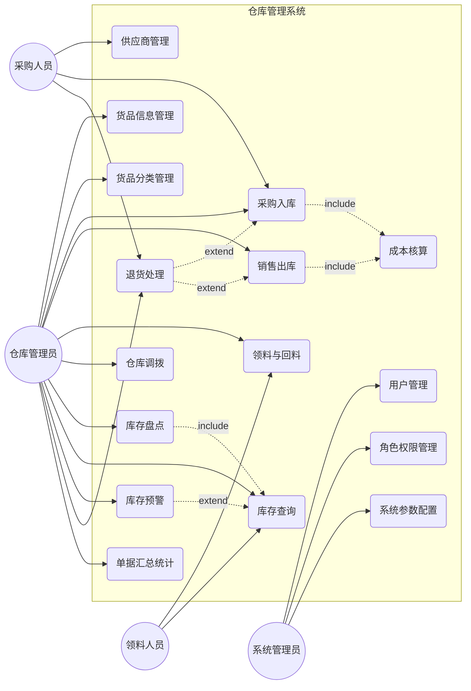
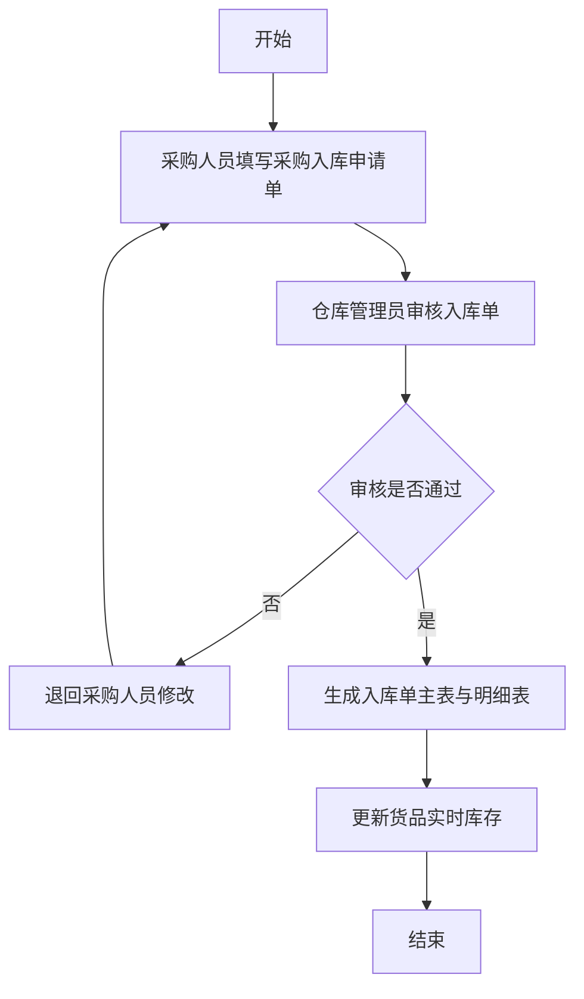
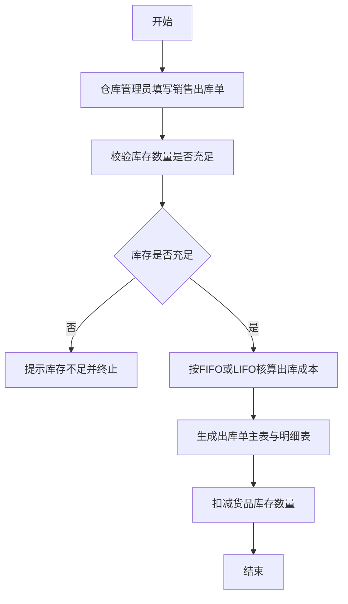
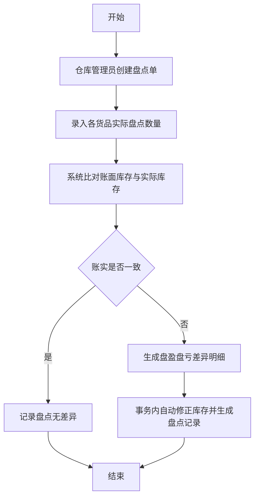
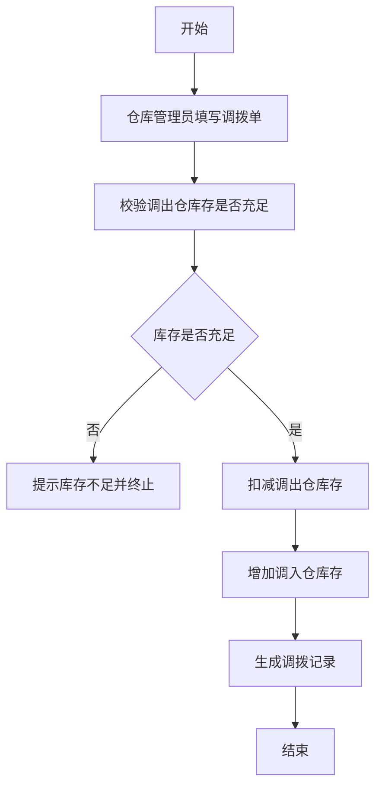
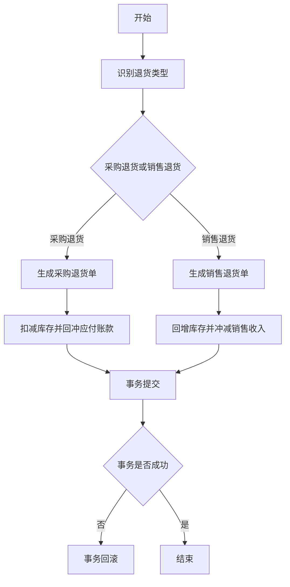
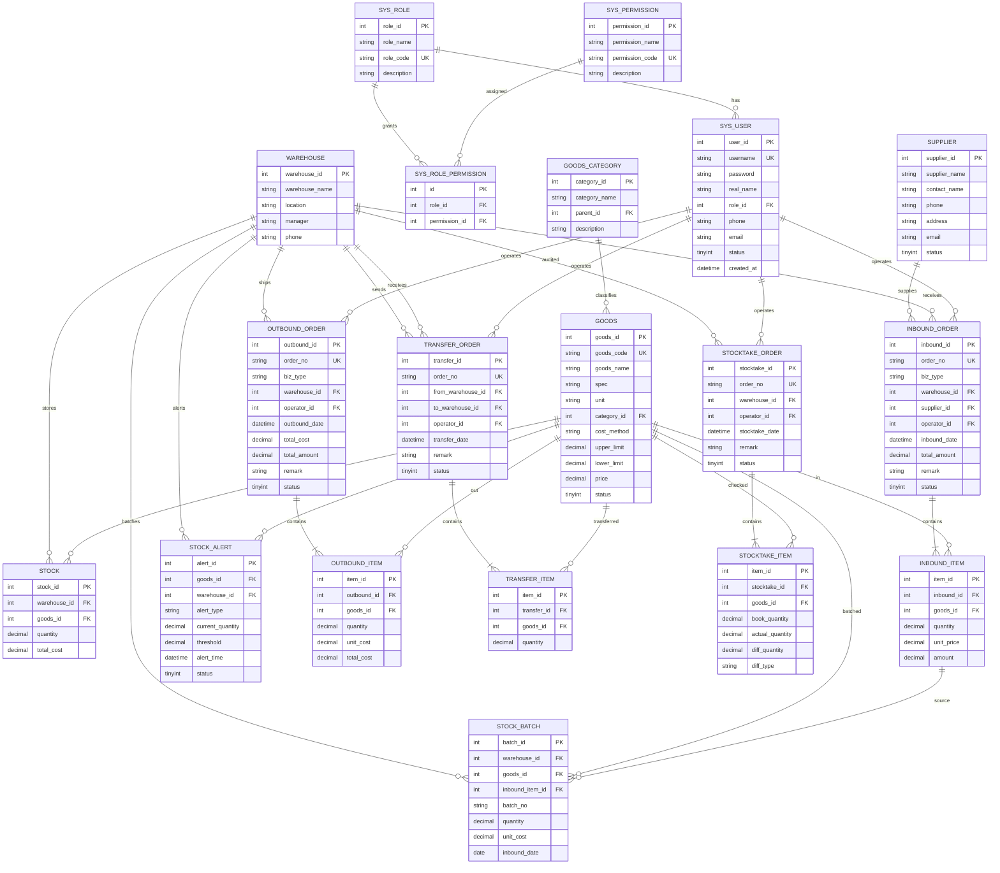

# 仓库管理系统数据库课程设计报告

| 项目 | 内容 |
| --- | --- |
| 课程名称 | 数据库系统课程设计 |
| 题目 | 仓库管理系统 |
| 技术栈 | Java + MySQL 8.0 + Spring Boot + MyBatis + Thymeleaf |
| 数据表数量 | 19 张（业务表 11 + 辅助表 8） |
| 考核点 | 三范式、触发器、存储过程、视图、事务、FIFO/LIFO 成本核算、库存预警 |

---

## 目录

1 摘要
2 绪论（开发背景与意义）
3 系统需求分析（功能/非功能需求、用例图、业务流程图）
4 系统总体方案设计（技术架构：Java+MySQL）
5 数据库概念设计（ER图详细说明、实体关系解释）
6 数据库逻辑设计（表结构、第三范式分析）
7 数据库物理设计（建表语句、索引设计）
8 数据库高级对象实现（存储过程、触发器、视图、事务）
9 系统功能模块Java代码实现
10 系统测试（测试数据、业务流程演示说明）
11 总结与心得体会

---

# 1 摘要

仓库管理系统是面向企业仓储业务的管理信息系统，覆盖采购入库、销售出库、退货、领料、回料、仓库调拨、库存盘点等完整仓储流程。本课题采用 Java + MySQL 8.0 技术栈，以数据库课程设计为核心，重点运用关系数据库的概念设计、逻辑设计、物理设计方法，并落地三范式、主外键完整性约束、索引、视图、触发器、存储过程、事务回滚等数据库技术。

本设计共包含 19 张数据表（业务表 11 张、辅助表 8 张），全部满足第三范式；实现先进先出（FIFO）与后进先出（LIFO）两种货品出库成本核算方式；通过 8 个触发器实现库存自动联动与超储/短缺预警；通过 4 个带事务的存储过程封装入库、出库成本核算、盘点、调拨核心业务；通过 4 个视图封装常用统计查询。系统配套 Spring Boot + Thymeleaf 极简前端，业务逻辑下沉到数据库侧，突出数据库课程设计重点。测试阶段满足单表实体数据不少于 30 条、全库关联记录不少于 200 条的硬性指标。

**关键词**：仓库管理；数据库设计；三范式；触发器；存储过程；事务；FIFO/LIFO 成本核算

---

# 2 绪论（开发背景与意义）

## 2.1 开发背景

随着企业生产与经营规模不断扩大，仓库中物料的种类、数量以及进出库业务日益频繁。传统手工记账或电子表格管理方式存在数据冗余、账实不符、查询统计困难、成本核算不准确等突出问题，已难以满足现代企业对仓储管理精细化、实时化、可追溯的要求。

仓库管理系统是典型的管理信息系统（MIS），其业务覆盖采购入库、销售出库、退货、领料、回料、仓库调拨、库存盘点等完整仓储流程，实体关系复杂、数据关联度高，是考察数据库概念设计、逻辑设计、物理设计以及高级数据库对象应用能力的理想选题。

## 2.2 开发目标与意义

1. **功能目标**：实现仓储全流程业务信息化管理，支持多角色协同操作。
2. **成本核算目标**：实现 FIFO、LIFO 两种货品出库成本核算，为库存资金占用与经营分析提供准确依据。
3. **决策支持目标**：提供任意时间段库存查询、库存数量与占用资金汇总统计、多维度业务单据汇总报表。
4. **风险控制目标**：实现库存上下限自动预警，对退货、盘盈盘亏等异常业务严格事务处理与回滚，保证账实一致。
5. **技术目标**：严格遵循数据库三范式设计，落地主外键约束、索引、视图、触发器、存储过程、事务回滚等数据库技术，突出数据库课程设计重点。

---

# 3 系统需求分析

## 3.1 功能性需求

系统按职能划分为四类操作角色：

| 角色 | 主要职责 | 对应业务 |
| --- | --- | --- |
| 系统管理员 | 系统维护、权限控制 | 用户管理、角色权限管理、系统参数配置 |
| 仓库管理员 | 仓储核心业务执行 | 货品管理、出入库、调拨、盘点、预警、成本核算、统计 |
| 采购人员 | 采购与供应商管理 | 供应商管理、采购入库登记、采购退货 |
| 领料人员 | 生产领料与回料 | 领料申请、回料登记 |

核心业务功能：

1. 采购入库：审核通过后生成入库单及明细，自动累加库存并生成成本批次。
2. 销售出库：按货品计价方式（FIFO/LIFO）自动核算出库成本，扣减库存。
3. 领料与回料：领料出库扣减、回料入库回增库存。
4. 退货处理：采购退货（出库方向）与销售退货（入库方向），异常业务事务处理。
5. 仓库调拨：跨仓库库存转移，源仓扣减、目标仓增加。
6. 库存盘点：录入实盘数量，自动比对账实差异，生成盘盈盘亏记录并修正库存。
7. 库存查询：按任意时间段、货品、仓库等维度查询库存数量及变动明细。
8. 库存预警：超储（高于上限）与短缺（低于下限）自动预警。
9. 单据汇总统计：按供应商、货品、仓库、时间等维度生成汇总报表。

## 3.2 非功能性需求

1. **性能需求**：常用单表查询响应秒级；对货品编号、单据日期、供应商编号、仓库编号等高频字段建立索引。
2. **安全性需求**：基于角色的访问控制；用户密码加密存储；高风险操作（库存修正、盘点）权限分级。
3. **可维护性需求**：Java 分层架构（Entity/DAO/Service/Controller），数据库对象命名规范、注释详细。
4. **数据一致性需求**：入库、出库、盘点、调拨、退货等业务使用事务保证原子性；库存增减通过触发器或存储过程自动联动。

## 3.3 系统用例图



## 3.4 业务流程图

### 3.4.1 采购入库流程



### 3.4.2 销售出库流程



### 3.4.3 库存盘点流程



### 3.4.4 仓库调拨流程



### 3.4.5 退货异常处理流程



---

# 4 系统总体方案设计

## 4.1 技术架构

本系统采用 **Java + MySQL 8.0** 技术栈，后端使用 Spring Boot + MyBatis，前端使用 Thymeleaf 模板引擎，整体为经典 B/S 分层架构：

| 层 | 技术 | 职责 |
| --- | --- | --- |
| 表现层 | Thymeleaf + HTML/CSS | 页面展示与交互，极简整洁 |
| 控制层 | Spring MVC Controller | 接收请求、参数绑定、页面跳转 |
| 业务层 | Spring Service | 参数校验、业务组装、调用存储过程 |
| 数据访问层 | MyBatis Mapper | 表查询、视图查询、存储过程调用 |
| 数据层 | MySQL 8.0 | 表、视图、触发器、存储过程、事务 |

## 4.2 设计思想

1. **业务逻辑下沉数据库**：FIFO/LIFO 成本核算、入库、盘点、调拨等业务主体在存储过程侧实现，Java 层不重写成本算法。
2. **触发器自动联动**：库存累加、出库审核扣减、库存预警、删除修改回滚由触发器自动完成，Java 不重复编写库存更新逻辑。
3. **视图封装查询**：库存总览、预警货品等常用查询封装为视图，简化上层开发。
4. **事务保证一致性**：高风险业务（退货、盘点、调拨、成本核算）在存储过程内使用事务，异常整体回滚。

---

# 5 数据库概念设计

## 5.1 实体清单

系统共抽象出 19 个实体，分为六大模块：

| 模块 | 实体 |
| --- | --- |
| 系统权限 | SYS_USER、SYS_ROLE、SYS_PERMISSION、SYS_ROLE_PERMISSION |
| 基础资料 | GOODS_CATEGORY、SUPPLIER、WAREHOUSE、GOODS |
| 库存台账 | STOCK、STOCK_BATCH |
| 出入库单据 | INBOUND_ORDER、INBOUND_ITEM、OUTBOUND_ORDER、OUTBOUND_ITEM |
| 业务单据 | TRANSFER_ORDER、TRANSFER_ITEM、STOCKTAKE_ORDER、STOCKTAKE_ITEM |
| 库存预警 | STOCK_ALERT |

## 5.2 ER 图



## 5.3 实体关系解释

### 5.3.1 一对多关系（1:N）

| 关系 | 一方 | 多方 | 说明 |
| --- | --- | --- | --- |
| 角色-用户 | SYS_ROLE | SYS_USER | 一个角色对应多个用户 |
| 分类-货品 | GOODS_CATEGORY | GOODS | 一个分类包含多个货品 |
| 供应商-入库单 | SUPPLIER | INBOUND_ORDER | 一个供应商对应多张入库单 |
| 仓库-库存 | WAREHOUSE | STOCK | 一个仓库对应多条库存记录 |
| 货品-库存 | GOODS | STOCK | 一个货品对应多条库存记录 |
| 货品-批次 | GOODS | STOCK_BATCH | 一个货品对应多个成本批次 |
| 入库单-明细 | INBOUND_ORDER | INBOUND_ITEM | 一张入库单含多条明细 |
| 出库单-明细 | OUTBOUND_ORDER | OUTBOUND_ITEM | 一张出库单含多条明细 |
| 调拨单-明细 | TRANSFER_ORDER | TRANSFER_ITEM | 一张调拨单含多条明细 |
| 盘点单-明细 | STOCKTAKE_ORDER | STOCKTAKE_ITEM | 一张盘点单含多条明细 |
| 用户-单据 | SYS_USER | 各类单据 | 一个操作人经办多张单据 |

### 5.3.2 多对多关系（M:N，已拆分中间表）

| 关系 | 实体A | 实体B | 中间表 | 说明 |
| --- | --- | --- | --- | --- |
| 角色-权限 | SYS_ROLE | SYS_PERMISSION | SYS_ROLE_PERMISSION | 一个角色拥有多个权限，一个权限可分配给多个角色 |

### 5.3.3 双重关联

`TRANSFER_ORDER` 通过 `from_warehouse_id`、`to_warehouse_id` 同时关联 `WAREHOUSE`，分别表示调出仓库与调入仓库。

---

# 6 数据库逻辑设计

## 6.1 表结构总览

共 19 张表，业务表 11 张、辅助表 8 张：

| 序号 | 表名 | 中文名 | 类型 | 说明 |
| --- | --- | --- | --- | --- |
| 1 | sys_role | 角色表 | 辅助 | 系统角色 |
| 2 | sys_permission | 权限表 | 辅助 | 功能权限 |
| 3 | sys_role_permission | 角色权限中间表 | 辅助 | 角色-权限多对多 |
| 4 | sys_user | 用户表 | 辅助 | 系统操作人员 |
| 5 | goods_category | 货品分类表 | 辅助 | 货品多级分类 |
| 6 | supplier | 供应商表 | 辅助 | 供应商主数据 |
| 7 | warehouse | 仓库表 | 辅助 | 仓库主数据 |
| 8 | goods | 货品基础信息表 | 辅助 | 货品主数据（含上下限阈值、计价方式） |
| 9 | stock | 库存表 | 业务 | 实时库存台账 |
| 10 | inbound_order | 入库单主表 | 业务 | 采购入库/退货/回料/盘盈/调拨入 |
| 11 | inbound_item | 入库明细表 | 业务 | 入库单明细 |
| 12 | outbound_order | 出库单主表 | 业务 | 销售出库/领料/采购退货/盘亏/调拨出 |
| 13 | outbound_item | 出库明细表 | 业务 | 出库单明细（含成本） |
| 14 | transfer_order | 调拨单主表 | 业务 | 跨仓库调拨 |
| 15 | transfer_item | 调拨明细表 | 业务 | 调拨明细 |
| 16 | stocktake_order | 盘点单主表 | 业务 | 库存盘点 |
| 17 | stocktake_item | 盘点明细表 | 业务 | 盘点账实比对 |
| 18 | stock_batch | 成本批次表 | 业务 | FIFO/LIFO 核算依据 |
| 19 | stock_alert | 库存预警记录表 | 业务 | 超储/短缺预警 |

## 6.2 关键字段设计

| 字段 | 所在表 | 作用 |
| --- | --- | --- |
| cost_method | goods | 标记货品计价方式（FIFO/LIFO） |
| upper_limit / lower_limit | goods | 库存上/下限阈值，供预警判断 |
| quantity / total_cost | stock | 实时库存数量与占用资金 |
| quantity / unit_cost / inbound_date | stock_batch | 成本批次剩余数量、单位成本、入库日期 |
| biz_type | inbound_order / outbound_order | 单据业务类型，统一承载采购/销售/退货/领料/回料/盘点/调拨 |
| unit_cost / total_cost | outbound_item | 出库成本计算结果 |
| diff_quantity / diff_type | stocktake_item | 盘点差异数量与盘盈盘亏类型 |
| alert_type | stock_alert | 预警类型（超储/短缺） |

## 6.3 第三范式（3NF）分析

### 6.3.1 第一范式（1NF）

所有表字段均为原子值，不存在重复组或多值字段。出入库、调拨、盘点单据均采用「主表 + 明细表」拆分，避免同一行存储多货品明细。

### 6.3.2 第二范式（2NF）

各表均以单一主键标识，不存在复合主键导致的部分函数依赖。明细表主键为 `item_id`，非主键属性完全依赖于主键。

### 6.3.3 第三范式（3NF）

各表消除传递依赖，非主键属性仅直接依赖于主键：

| 潜在冗余/依赖问题 | 处理方式 |
| --- | --- |
| 单据表冗余供应商名称 | 供应商信息独立成 SUPPLIER 表 |
| 明细表冗余货品名称/单位 | 货品信息独立成 GOODS 表 |
| 单据表冗余仓库名称/位置 | 仓库信息独立成 WAREHOUSE 表 |
| 出库成本无法追溯来源 | 成本批次独立成 STOCK_BATCH 表 |
| 角色权限直接多对多 | 拆分为 SYS_ROLE_PERMISSION 中间表 |

经逐项检查，全部 19 张表均满足第三范式。

---

# 7 数据库物理设计

## 7.1 建表语句

采用 InnoDB 存储引擎（支持事务、行级锁与外键约束）、utf8mb4 字符集（完整支持中文注释）、DECIMAL(12,2) 存储金额与数量。完整建表 SQL 如下：

```sql
-- 角色表
CREATE TABLE sys_role (
    role_id INT UNSIGNED NOT NULL AUTO_INCREMENT COMMENT '角色编号',
    role_name VARCHAR(50) NOT NULL COMMENT '角色名称',
    role_code VARCHAR(50) NOT NULL COMMENT '角色编码',
    description VARCHAR(255) DEFAULT NULL COMMENT '角色描述',
    PRIMARY KEY (role_id),
    UNIQUE KEY uk_role_code (role_code)
) ENGINE=InnoDB DEFAULT CHARSET=utf8mb4 COMMENT='角色表';

-- 权限表
CREATE TABLE sys_permission (
    permission_id INT UNSIGNED NOT NULL AUTO_INCREMENT COMMENT '权限编号',
    permission_name VARCHAR(50) NOT NULL COMMENT '权限名称',
    permission_code VARCHAR(100) NOT NULL COMMENT '权限编码',
    description VARCHAR(255) DEFAULT NULL COMMENT '权限描述',
    PRIMARY KEY (permission_id),
    UNIQUE KEY uk_permission_code (permission_code)
) ENGINE=InnoDB DEFAULT CHARSET=utf8mb4 COMMENT='权限表';

-- 角色权限中间表（多对多）
CREATE TABLE sys_role_permission (
    id INT UNSIGNED NOT NULL AUTO_INCREMENT COMMENT '主键',
    role_id INT UNSIGNED NOT NULL COMMENT '角色编号',
    permission_id INT UNSIGNED NOT NULL COMMENT '权限编号',
    PRIMARY KEY (id),
    UNIQUE KEY uk_role_permission (role_id, permission_id),
    KEY idx_role_id (role_id),
    KEY idx_permission_id (permission_id),
    CONSTRAINT fk_rp_role FOREIGN KEY (role_id) REFERENCES sys_role (role_id) ON DELETE CASCADE ON UPDATE CASCADE,
    CONSTRAINT fk_rp_permission FOREIGN KEY (permission_id) REFERENCES sys_permission (permission_id) ON DELETE CASCADE ON UPDATE CASCADE
) ENGINE=InnoDB DEFAULT CHARSET=utf8mb4 COMMENT='角色权限中间表';

-- 用户表
CREATE TABLE sys_user (
    user_id INT UNSIGNED NOT NULL AUTO_INCREMENT COMMENT '用户编号',
    username VARCHAR(50) NOT NULL COMMENT '登录账号',
    password VARCHAR(100) NOT NULL COMMENT '加密密码',
    real_name VARCHAR(50) NOT NULL COMMENT '真实姓名',
    role_id INT UNSIGNED NOT NULL COMMENT '所属角色编号',
    phone VARCHAR(20) DEFAULT NULL COMMENT '联系电话',
    email VARCHAR(100) DEFAULT NULL COMMENT '邮箱',
    status TINYINT NOT NULL DEFAULT 1 COMMENT '状态(1启用 0禁用)',
    created_at DATETIME NOT NULL DEFAULT CURRENT_TIMESTAMP COMMENT '创建时间',
    PRIMARY KEY (user_id),
    UNIQUE KEY uk_username (username),
    KEY idx_role_id (role_id),
    CONSTRAINT fk_user_role FOREIGN KEY (role_id) REFERENCES sys_role (role_id) ON DELETE RESTRICT ON UPDATE CASCADE
) ENGINE=InnoDB DEFAULT CHARSET=utf8mb4 COMMENT='用户表';

-- 货品分类表（自关联多级分类）
CREATE TABLE goods_category (
    category_id INT UNSIGNED NOT NULL AUTO_INCREMENT COMMENT '分类编号',
    category_name VARCHAR(50) NOT NULL COMMENT '分类名称',
    parent_id INT UNSIGNED DEFAULT NULL COMMENT '上级分类编号(自关联)',
    description VARCHAR(255) DEFAULT NULL COMMENT '分类描述',
    PRIMARY KEY (category_id),
    KEY idx_parent_id (parent_id),
    CONSTRAINT fk_category_parent FOREIGN KEY (parent_id) REFERENCES goods_category (category_id) ON DELETE SET NULL ON UPDATE CASCADE
) ENGINE=InnoDB DEFAULT CHARSET=utf8mb4 COMMENT='货品分类表';

-- 供应商表
CREATE TABLE supplier (
    supplier_id INT UNSIGNED NOT NULL AUTO_INCREMENT COMMENT '供应商编号',
    supplier_name VARCHAR(100) NOT NULL COMMENT '供应商名称',
    contact_name VARCHAR(50) DEFAULT NULL COMMENT '联系人',
    phone VARCHAR(20) DEFAULT NULL COMMENT '联系电话',
    address VARCHAR(255) DEFAULT NULL COMMENT '联系地址',
    email VARCHAR(100) DEFAULT NULL COMMENT '邮箱',
    status TINYINT NOT NULL DEFAULT 1 COMMENT '状态(1启用 0禁用)',
    PRIMARY KEY (supplier_id),
    KEY idx_supplier_name (supplier_name)
) ENGINE=InnoDB DEFAULT CHARSET=utf8mb4 COMMENT='供应商表';

-- 仓库表
CREATE TABLE warehouse (
    warehouse_id INT UNSIGNED NOT NULL AUTO_INCREMENT COMMENT '仓库编号',
    warehouse_name VARCHAR(100) NOT NULL COMMENT '仓库名称',
    location VARCHAR(255) DEFAULT NULL COMMENT '仓库位置',
    manager VARCHAR(50) DEFAULT NULL COMMENT '负责人',
    phone VARCHAR(20) DEFAULT NULL COMMENT '联系电话',
    PRIMARY KEY (warehouse_id)
) ENGINE=InnoDB DEFAULT CHARSET=utf8mb4 COMMENT='仓库表';

-- 货品基础信息表（含库存上下限阈值与计价方式）
CREATE TABLE goods (
    goods_id INT UNSIGNED NOT NULL AUTO_INCREMENT COMMENT '货品编号',
    goods_code VARCHAR(50) NOT NULL COMMENT '货品编码',
    goods_name VARCHAR(100) NOT NULL COMMENT '货品名称',
    spec VARCHAR(100) DEFAULT NULL COMMENT '规格型号',
    unit VARCHAR(20) NOT NULL DEFAULT '个' COMMENT '计量单位',
    category_id INT UNSIGNED NOT NULL COMMENT '所属分类编号',
    cost_method VARCHAR(10) NOT NULL DEFAULT 'FIFO' COMMENT '计价方式(FIFO/LIFO)',
    upper_limit DECIMAL(12,2) NOT NULL DEFAULT 0.00 COMMENT '库存上限阈值',
    lower_limit DECIMAL(12,2) NOT NULL DEFAULT 0.00 COMMENT '库存下限阈值',
    price DECIMAL(12,2) NOT NULL DEFAULT 0.00 COMMENT '参考售价',
    status TINYINT NOT NULL DEFAULT 1 COMMENT '状态(1启用 0禁用)',
    PRIMARY KEY (goods_id),
    UNIQUE KEY uk_goods_code (goods_code),
    KEY idx_category_id (category_id),
    KEY idx_goods_name (goods_name),
    CONSTRAINT fk_goods_category FOREIGN KEY (category_id) REFERENCES goods_category (category_id) ON DELETE RESTRICT ON UPDATE CASCADE,
    CONSTRAINT chk_goods_limit CHECK (upper_limit >= lower_limit)
) ENGINE=InnoDB DEFAULT CHARSET=utf8mb4 COMMENT='货品基础信息表';

-- 库存表
CREATE TABLE stock (
    stock_id INT UNSIGNED NOT NULL AUTO_INCREMENT COMMENT '库存编号',
    warehouse_id INT UNSIGNED NOT NULL COMMENT '仓库编号',
    goods_id INT UNSIGNED NOT NULL COMMENT '货品编号',
    quantity DECIMAL(12,2) NOT NULL DEFAULT 0.00 COMMENT '当前库存数量',
    total_cost DECIMAL(12,2) NOT NULL DEFAULT 0.00 COMMENT '库存占用资金',
    PRIMARY KEY (stock_id),
    UNIQUE KEY uk_warehouse_goods (warehouse_id, goods_id),
    KEY idx_goods_id (goods_id),
    KEY idx_warehouse_id (warehouse_id),
    CONSTRAINT fk_stock_warehouse FOREIGN KEY (warehouse_id) REFERENCES warehouse (warehouse_id) ON DELETE RESTRICT ON UPDATE CASCADE,
    CONSTRAINT fk_stock_goods FOREIGN KEY (goods_id) REFERENCES goods (goods_id) ON DELETE RESTRICT ON UPDATE CASCADE,
    CONSTRAINT chk_stock_quantity CHECK (quantity >= 0)
) ENGINE=InnoDB DEFAULT CHARSET=utf8mb4 COMMENT='库存表';

-- 成本批次表（FIFO/LIFO 核算依据）
CREATE TABLE stock_batch (
    batch_id INT UNSIGNED NOT NULL AUTO_INCREMENT COMMENT '批次编号',
    warehouse_id INT UNSIGNED NOT NULL COMMENT '仓库编号',
    goods_id INT UNSIGNED NOT NULL COMMENT '货品编号',
    inbound_item_id INT UNSIGNED NOT NULL COMMENT '来源入库明细编号',
    batch_no VARCHAR(50) NOT NULL COMMENT '批次号',
    quantity DECIMAL(12,2) NOT NULL DEFAULT 0.00 COMMENT '批次剩余数量',
    unit_cost DECIMAL(12,2) NOT NULL DEFAULT 0.00 COMMENT '批次单位成本',
    inbound_date DATE NOT NULL COMMENT '入库日期',
    PRIMARY KEY (batch_id),
    UNIQUE KEY uk_inbound_item (inbound_item_id),
    KEY idx_batch_query (warehouse_id, goods_id, inbound_date),
    KEY idx_goods_id (goods_id),
    CONSTRAINT fk_batch_warehouse FOREIGN KEY (warehouse_id) REFERENCES warehouse (warehouse_id) ON DELETE RESTRICT ON UPDATE CASCADE,
    CONSTRAINT fk_batch_goods FOREIGN KEY (goods_id) REFERENCES goods (goods_id) ON DELETE RESTRICT ON UPDATE CASCADE,
    CONSTRAINT fk_batch_inbound_item FOREIGN KEY (inbound_item_id) REFERENCES inbound_item (item_id) ON DELETE RESTRICT ON UPDATE CASCADE,
    CONSTRAINT chk_batch_quantity CHECK (quantity >= 0)
) ENGINE=InnoDB DEFAULT CHARSET=utf8mb4 COMMENT='成本批次表(FIFO/LIFO核算依据)';

-- 入库单主表
CREATE TABLE inbound_order (
    inbound_id INT UNSIGNED NOT NULL AUTO_INCREMENT COMMENT '入库单编号',
    order_no VARCHAR(50) NOT NULL COMMENT '单据编号',
    biz_type VARCHAR(20) NOT NULL COMMENT '业务类型(采购入库/销售退货/回料/盘盈/调拨入)',
    warehouse_id INT UNSIGNED NOT NULL COMMENT '入库仓库编号',
    supplier_id INT UNSIGNED DEFAULT NULL COMMENT '供应商编号(采购入库)',
    operator_id INT UNSIGNED NOT NULL COMMENT '操作人编号',
    inbound_date DATETIME NOT NULL DEFAULT CURRENT_TIMESTAMP COMMENT '入库日期',
    total_amount DECIMAL(12,2) NOT NULL DEFAULT 0.00 COMMENT '入库总金额',
    remark VARCHAR(255) DEFAULT NULL COMMENT '备注',
    status TINYINT NOT NULL DEFAULT 0 COMMENT '单据状态(0待审核 1已审核 2作废)',
    PRIMARY KEY (inbound_id),
    UNIQUE KEY uk_order_no (order_no),
    KEY idx_warehouse_id (warehouse_id),
    KEY idx_supplier_id (supplier_id),
    KEY idx_operator_id (operator_id),
    KEY idx_inbound_date (inbound_date),
    KEY idx_biz_type (biz_type),
    CONSTRAINT fk_ib_warehouse FOREIGN KEY (warehouse_id) REFERENCES warehouse (warehouse_id) ON DELETE RESTRICT ON UPDATE CASCADE,
    CONSTRAINT fk_ib_supplier FOREIGN KEY (supplier_id) REFERENCES supplier (supplier_id) ON DELETE RESTRICT ON UPDATE CASCADE,
    CONSTRAINT fk_ib_operator FOREIGN KEY (operator_id) REFERENCES sys_user (user_id) ON DELETE RESTRICT ON UPDATE CASCADE
) ENGINE=InnoDB DEFAULT CHARSET=utf8mb4 COMMENT='入库单主表';

-- 入库明细表
CREATE TABLE inbound_item (
    item_id INT UNSIGNED NOT NULL AUTO_INCREMENT COMMENT '明细编号',
    inbound_id INT UNSIGNED NOT NULL COMMENT '入库单编号',
    goods_id INT UNSIGNED NOT NULL COMMENT '货品编号',
    quantity DECIMAL(12,2) NOT NULL COMMENT '入库数量',
    unit_price DECIMAL(12,2) NOT NULL DEFAULT 0.00 COMMENT '入库单价',
    amount DECIMAL(12,2) NOT NULL DEFAULT 0.00 COMMENT '金额',
    PRIMARY KEY (item_id),
    KEY idx_inbound_id (inbound_id),
    KEY idx_goods_id (goods_id),
    CONSTRAINT fk_ibi_order FOREIGN KEY (inbound_id) REFERENCES inbound_order (inbound_id) ON DELETE CASCADE ON UPDATE CASCADE,
    CONSTRAINT fk_ibi_goods FOREIGN KEY (goods_id) REFERENCES goods (goods_id) ON DELETE RESTRICT ON UPDATE CASCADE
) ENGINE=InnoDB DEFAULT CHARSET=utf8mb4 COMMENT='入库明细表';

-- 出库单主表
CREATE TABLE outbound_order (
    outbound_id INT UNSIGNED NOT NULL AUTO_INCREMENT COMMENT '出库单编号',
    order_no VARCHAR(50) NOT NULL COMMENT '单据编号',
    biz_type VARCHAR(20) NOT NULL COMMENT '业务类型(销售出库/领料/采购退货/盘亏/调拨出)',
    warehouse_id INT UNSIGNED NOT NULL COMMENT '出库仓库编号',
    operator_id INT UNSIGNED NOT NULL COMMENT '操作人编号',
    outbound_date DATETIME NOT NULL DEFAULT CURRENT_TIMESTAMP COMMENT '出库日期',
    total_cost DECIMAL(12,2) NOT NULL DEFAULT 0.00 COMMENT '出库总成本',
    total_amount DECIMAL(12,2) NOT NULL DEFAULT 0.00 COMMENT '出库总金额',
    remark VARCHAR(255) DEFAULT NULL COMMENT '备注',
    status TINYINT NOT NULL DEFAULT 0 COMMENT '单据状态(0待审核 1已审核 2作废)',
    PRIMARY KEY (outbound_id),
    UNIQUE KEY uk_order_no (order_no),
    KEY idx_warehouse_id (warehouse_id),
    KEY idx_operator_id (operator_id),
    KEY idx_outbound_date (outbound_date),
    KEY idx_biz_type (biz_type),
    CONSTRAINT fk_ob_warehouse FOREIGN KEY (warehouse_id) REFERENCES warehouse (warehouse_id) ON DELETE RESTRICT ON UPDATE CASCADE,
    CONSTRAINT fk_ob_operator FOREIGN KEY (operator_id) REFERENCES sys_user (user_id) ON DELETE RESTRICT ON UPDATE CASCADE
) ENGINE=InnoDB DEFAULT CHARSET=utf8mb4 COMMENT='出库单主表';

-- 出库明细表（含 FIFO/LIFO 计算结果）
CREATE TABLE outbound_item (
    item_id INT UNSIGNED NOT NULL AUTO_INCREMENT COMMENT '明细编号',
    outbound_id INT UNSIGNED NOT NULL COMMENT '出库单编号',
    goods_id INT UNSIGNED NOT NULL COMMENT '货品编号',
    quantity DECIMAL(12,2) NOT NULL COMMENT '出库数量',
    unit_cost DECIMAL(12,2) NOT NULL DEFAULT 0.00 COMMENT '单位成本(FIFO/LIFO计算)',
    total_cost DECIMAL(12,2) NOT NULL DEFAULT 0.00 COMMENT '成本金额',
    PRIMARY KEY (item_id),
    KEY idx_outbound_id (outbound_id),
    KEY idx_goods_id (goods_id),
    CONSTRAINT fk_obi_order FOREIGN KEY (outbound_id) REFERENCES outbound_order (outbound_id) ON DELETE CASCADE ON UPDATE CASCADE,
    CONSTRAINT fk_obi_goods FOREIGN KEY (goods_id) REFERENCES goods (goods_id) ON DELETE RESTRICT ON UPDATE CASCADE
) ENGINE=InnoDB DEFAULT CHARSET=utf8mb4 COMMENT='出库明细表';

-- 调拨单主表
CREATE TABLE transfer_order (
    transfer_id INT UNSIGNED NOT NULL AUTO_INCREMENT COMMENT '调拨单编号',
    order_no VARCHAR(50) NOT NULL COMMENT '单据编号',
    from_warehouse_id INT UNSIGNED NOT NULL COMMENT '调出仓库编号',
    to_warehouse_id INT UNSIGNED NOT NULL COMMENT '调入仓库编号',
    operator_id INT UNSIGNED NOT NULL COMMENT '操作人编号',
    transfer_date DATETIME NOT NULL DEFAULT CURRENT_TIMESTAMP COMMENT '调拨日期',
    remark VARCHAR(255) DEFAULT NULL COMMENT '备注',
    status TINYINT NOT NULL DEFAULT 0 COMMENT '单据状态(0待审核 1已审核 2作废)',
    PRIMARY KEY (transfer_id),
    UNIQUE KEY uk_order_no (order_no),
    KEY idx_from_warehouse (from_warehouse_id),
    KEY idx_to_warehouse (to_warehouse_id),
    KEY idx_operator_id (operator_id),
    CONSTRAINT fk_tf_from FOREIGN KEY (from_warehouse_id) REFERENCES warehouse (warehouse_id) ON DELETE RESTRICT ON UPDATE CASCADE,
    CONSTRAINT fk_tf_to FOREIGN KEY (to_warehouse_id) REFERENCES warehouse (warehouse_id) ON DELETE RESTRICT ON UPDATE CASCADE,
    CONSTRAINT fk_tf_operator FOREIGN KEY (operator_id) REFERENCES sys_user (user_id) ON DELETE RESTRICT ON UPDATE CASCADE
) ENGINE=InnoDB DEFAULT CHARSET=utf8mb4 COMMENT='调拨单主表';

-- 调拨明细表
CREATE TABLE transfer_item (
    item_id INT UNSIGNED NOT NULL AUTO_INCREMENT COMMENT '明细编号',
    transfer_id INT UNSIGNED NOT NULL COMMENT '调拨单编号',
    goods_id INT UNSIGNED NOT NULL COMMENT '货品编号',
    quantity DECIMAL(12,2) NOT NULL COMMENT '调拨数量',
    PRIMARY KEY (item_id),
    KEY idx_transfer_id (transfer_id),
    KEY idx_goods_id (goods_id),
    CONSTRAINT fk_ti_order FOREIGN KEY (transfer_id) REFERENCES transfer_order (transfer_id) ON DELETE CASCADE ON UPDATE CASCADE,
    CONSTRAINT fk_ti_goods FOREIGN KEY (goods_id) REFERENCES goods (goods_id) ON DELETE RESTRICT ON UPDATE CASCADE
) ENGINE=InnoDB DEFAULT CHARSET=utf8mb4 COMMENT='调拨明细表';

-- 盘点单主表
CREATE TABLE stocktake_order (
    stocktake_id INT UNSIGNED NOT NULL AUTO_INCREMENT COMMENT '盘点单编号',
    order_no VARCHAR(50) NOT NULL COMMENT '单据编号',
    warehouse_id INT UNSIGNED NOT NULL COMMENT '盘点仓库编号',
    operator_id INT UNSIGNED NOT NULL COMMENT '操作人编号',
    stocktake_date DATETIME NOT NULL DEFAULT CURRENT_TIMESTAMP COMMENT '盘点日期',
    remark VARCHAR(255) DEFAULT NULL COMMENT '备注',
    status TINYINT NOT NULL DEFAULT 0 COMMENT '单据状态(0待审核 1已审核 2作废)',
    PRIMARY KEY (stocktake_id),
    UNIQUE KEY uk_order_no (order_no),
    KEY idx_warehouse_id (warehouse_id),
    KEY idx_operator_id (operator_id),
    CONSTRAINT fk_st_warehouse FOREIGN KEY (warehouse_id) REFERENCES warehouse (warehouse_id) ON DELETE RESTRICT ON UPDATE CASCADE,
    CONSTRAINT fk_st_operator FOREIGN KEY (operator_id) REFERENCES sys_user (user_id) ON DELETE RESTRICT ON UPDATE CASCADE
) ENGINE=InnoDB DEFAULT CHARSET=utf8mb4 COMMENT='盘点单主表';

-- 盘点明细表
CREATE TABLE stocktake_item (
    item_id INT UNSIGNED NOT NULL AUTO_INCREMENT COMMENT '明细编号',
    stocktake_id INT UNSIGNED NOT NULL COMMENT '盘点单编号',
    goods_id INT UNSIGNED NOT NULL COMMENT '货品编号',
    book_quantity DECIMAL(12,2) NOT NULL DEFAULT 0.00 COMMENT '账面数量',
    actual_quantity DECIMAL(12,2) NOT NULL DEFAULT 0.00 COMMENT '实盘数量',
    diff_quantity DECIMAL(12,2) NOT NULL DEFAULT 0.00 COMMENT '差异数量',
    diff_type VARCHAR(10) DEFAULT 'NONE' COMMENT '差异类型(GAIN盘盈/LOSS盘亏/NONE无差异)',
    PRIMARY KEY (item_id),
    KEY idx_stocktake_id (stocktake_id),
    KEY idx_goods_id (goods_id),
    CONSTRAINT fk_sti_order FOREIGN KEY (stocktake_id) REFERENCES stocktake_order (stocktake_id) ON DELETE CASCADE ON UPDATE CASCADE,
    CONSTRAINT fk_sti_goods FOREIGN KEY (goods_id) REFERENCES goods (goods_id) ON DELETE RESTRICT ON UPDATE CASCADE
) ENGINE=InnoDB DEFAULT CHARSET=utf8mb4 COMMENT='盘点明细表';

-- 库存预警记录表（由触发器自动写入）
CREATE TABLE stock_alert (
    alert_id INT UNSIGNED NOT NULL AUTO_INCREMENT COMMENT '预警编号',
    goods_id INT UNSIGNED NOT NULL COMMENT '货品编号',
    warehouse_id INT UNSIGNED NOT NULL COMMENT '仓库编号',
    alert_type VARCHAR(10) NOT NULL COMMENT '预警类型(OVER超储/LOW短缺)',
    current_quantity DECIMAL(12,2) NOT NULL DEFAULT 0.00 COMMENT '当前库存数量',
    threshold DECIMAL(12,2) NOT NULL DEFAULT 0.00 COMMENT '触发阈值',
    alert_time DATETIME NOT NULL DEFAULT CURRENT_TIMESTAMP COMMENT '预警时间',
    status TINYINT NOT NULL DEFAULT 0 COMMENT '处理状态(0未处理 1已处理)',
    PRIMARY KEY (alert_id),
    KEY idx_goods_id (goods_id),
    KEY idx_warehouse_id (warehouse_id),
    KEY idx_status (status),
    CONSTRAINT fk_sa_goods FOREIGN KEY (goods_id) REFERENCES goods (goods_id) ON DELETE RESTRICT ON UPDATE CASCADE,
    CONSTRAINT fk_sa_warehouse FOREIGN KEY (warehouse_id) REFERENCES warehouse (warehouse_id) ON DELETE RESTRICT ON UPDATE CASCADE
) ENGINE=InnoDB DEFAULT CHARSET=utf8mb4 COMMENT='库存预警记录表';
```

## 7.2 索引设计

为查询高频字段建立索引，保证查询效率：

| 索引 | 所在表 | 用途 |
| --- | --- | --- |
| uk_goods_code | goods | 货品编码唯一 |
| idx_category_id / idx_goods_name | goods | 按分类、名称查询货品 |
| uk_warehouse_goods / idx_goods_id | stock | 库存定位与货品维度查询 |
| idx_batch_query(warehouse_id, goods_id, inbound_date) | stock_batch | FIFO/LIFO 批次扣减查询 |
| idx_warehouse_id / idx_supplier_id / idx_inbound_date / idx_biz_type | inbound_order | 入库单据多维查询 |
| idx_warehouse_id / idx_outbound_date / idx_biz_type | outbound_order | 出库单据多维查询 |
| idx_from_warehouse / idx_to_warehouse | transfer_order | 调拨仓库查询 |
| idx_warehouse_id | stocktake_order | 盘点单查询 |
| idx_goods_id / idx_warehouse_id / idx_status | stock_alert | 预警查询与处理 |

---

# 8 数据库高级对象实现

## 8.1 视图

共创建 4 个视图：`v_stock_overview`（实时库存总览）、`v_stock_warning`（超储/短缺预警货品）、`v_inout_summary`（出入库明细汇总）、`v_stock_batch_cost`（FIFO/LIFO 成本批次）。

```sql
CREATE VIEW v_stock_overview AS
SELECT
    s.stock_id, g.goods_code, g.goods_name, g.spec, g.unit,
    c.category_name, w.warehouse_id, w.warehouse_name,
    s.quantity AS stock_quantity, s.total_cost AS occupied_cost,
    g.lower_limit, g.upper_limit, g.cost_method,
    CASE
        WHEN s.quantity < g.lower_limit THEN 'LOW'
        WHEN s.quantity > g.upper_limit THEN 'OVER'
        ELSE 'NORMAL'
    END AS stock_status
FROM stock s
JOIN goods g ON s.goods_id = g.goods_id
JOIN warehouse w ON s.warehouse_id = w.warehouse_id
LEFT JOIN goods_category c ON g.category_id = c.category_id;
```

另附 8 条答辩演示统计 SQL，覆盖任意时间段出入库汇总、供应商供货金额、月度库存资金占用、滞销货品、盘点盈亏、领料回料等 6 类场景。

## 8.2 触发器

共 8 个触发器对象，对应 4 项功能需求，统一使用 AFTER 时机：

| 功能 | 触发器 | 时机 |
| --- | --- | --- |
| 入库累加 | trg_inbound_item_after_insert | AFTER INSERT ON inbound_item |
| 出库审核扣减 | trg_outbound_order_after_approve | AFTER UPDATE ON outbound_order |
| 库存预警 | trg_stock_after_insert / trg_stock_after_update | AFTER INSERT/UPDATE ON stock |
| 删除修改回滚 | trg_inbound_item_after_delete/update、trg_outbound_item_after_delete/update | AFTER DELETE/UPDATE ON 明细表 |

入库明细插入后自动累加库存示例：

```sql
CREATE TRIGGER trg_inbound_item_after_insert
AFTER INSERT ON inbound_item
FOR EACH ROW
BEGIN
    DECLARE v_warehouse_id INT UNSIGNED;
    SELECT warehouse_id INTO v_warehouse_id FROM inbound_order WHERE inbound_id = NEW.inbound_id;
    INSERT INTO stock (warehouse_id, goods_id, quantity, total_cost)
    VALUES (v_warehouse_id, NEW.goods_id, NEW.quantity, NEW.amount)
    ON DUPLICATE KEY UPDATE
        quantity = quantity + NEW.quantity,
        total_cost = total_cost + NEW.amount;
END;
```

## 8.3 存储过程（FIFO/LIFO 出库成本核算）

共 4 个存储过程，全部内置事务与异常回滚，统一 OUT 参数返回状态码与消息。

### 8.3.1 FIFO/LIFO 成本核算原理

1. 读取货品 `cost_method` 计价方式；
2. 校验批次总可用量，不足则报「库存不足」；
3. 用游标遍历成本批次：FIFO 按入库日期升序扣减，LIFO 按降序扣减；
4. 逐批扣减剩余数量，累加 `出库总成本 = Σ(本次扣减量 × 批次单价)`；
5. `单位成本 = 出库总成本 / 出库量`，写入出库明细，审核通过后由触发器扣减库存。

核心存储过程（出库成本核算，节选 FIFO/LIFO 游标逻辑）：

```sql
CREATE PROCEDURE sp_outbound_cost(
    IN  p_warehouse_id INT UNSIGNED, IN p_goods_id INT UNSIGNED,
    IN  p_quantity DECIMAL(12,2), IN p_operator_id INT UNSIGNED,
    IN  p_biz_type VARCHAR(20),
    OUT p_status_code INT, OUT p_status_msg VARCHAR(255), OUT p_out_total_cost DECIMAL(12,2)
)
BEGIN
    DECLARE v_cost_method VARCHAR(10);
    DECLARE v_is_lifo TINYINT DEFAULT 0;
    DECLARE v_remain DECIMAL(12,2);
    DECLARE v_total_cost DECIMAL(12,2) DEFAULT 0;
    DECLARE done INT DEFAULT 0;
    DECLARE v_batch_id INT UNSIGNED;
    DECLARE v_batch_qty DECIMAL(12,2);
    DECLARE v_batch_cost DECIMAL(12,2);
    DECLARE v_use_qty DECIMAL(12,2);

    DECLARE cur_fifo CURSOR FOR
        SELECT batch_id, quantity, unit_cost FROM stock_batch
        WHERE warehouse_id = p_warehouse_id AND goods_id = p_goods_id AND quantity > 0
        ORDER BY inbound_date ASC, batch_id ASC;

    DECLARE cur_lifo CURSOR FOR
        SELECT batch_id, quantity, unit_cost FROM stock_batch
        WHERE warehouse_id = p_warehouse_id AND goods_id = p_goods_id AND quantity > 0
        ORDER BY inbound_date DESC, batch_id DESC;

    DECLARE CONTINUE HANDLER FOR NOT FOUND SET done = 1;
    DECLARE EXIT HANDLER FOR SQLEXCEPTION
    BEGIN
        GET DIAGNOSTICS CONDITION 1 p_status_msg = MESSAGE_TEXT;
        ROLLBACK;
        SET p_status_code = 1;
    END;

    START TRANSACTION;
    SELECT cost_method INTO v_cost_method FROM goods WHERE goods_id = p_goods_id;
    IF v_cost_method = 'LIFO' THEN SET v_is_lifo = 1; END IF;
    SET v_remain = p_quantity;
    IF v_is_lifo = 1 THEN OPEN cur_lifo; ELSE OPEN cur_fifo; END IF;
    read_loop: LOOP
        IF v_is_lifo = 1 THEN FETCH cur_lifo INTO v_batch_id, v_batch_qty, v_batch_cost;
        ELSE FETCH cur_fifo INTO v_batch_id, v_batch_qty, v_batch_cost; END IF;
        IF done = 1 THEN LEAVE read_loop; END IF;
        IF v_batch_qty >= v_remain THEN SET v_use_qty = v_remain; ELSE SET v_use_qty = v_batch_qty; END IF;
        SET v_total_cost = v_total_cost + v_use_qty * v_batch_cost;
        SET v_remain = v_remain - v_use_qty;
        UPDATE stock_batch SET quantity = quantity - v_use_qty WHERE batch_id = v_batch_id;
        IF v_remain <= 0 THEN LEAVE read_loop; END IF;
    END LOOP;
    IF v_is_lifo = 1 THEN CLOSE cur_lifo; ELSE CLOSE cur_fifo; END IF;
    COMMIT;
    SET p_status_code = 0;
    SET p_out_total_cost = v_total_cost;
END;
```

其余三个存储过程：`sp_inbound`（入库）、`sp_stocktake`（盘点盘盈盘亏）、`sp_transfer`（批量调拨），均含事务与异常回滚。

## 8.4 事务与异常处理

所有存储过程统一采用 `START TRANSACTION / COMMIT / ROLLBACK` 结构，并声明 `EXIT HANDLER FOR SQLEXCEPTION` 捕获异常后回滚。以下高风险业务必须保证原子性：入库（主表+明细+批次）、出库成本核算（批次扣减+单据+库存扣减）、盘点（盘点单+明细+库存修正）、调拨（源仓扣减+目标仓增加）。

---

# 9 系统功能模块 Java 代码实现

## 9.1 项目分层结构

```
src/
├── pom.xml
└── src/main/
    ├── java/com/warehouse/
    │   ├── WarehouseApplication.java
    │   ├── controller/   # 控制层：Login/Goods/Business/Stock/DeepSeek
    │   ├── entity/       # 实体层：Goods/Warehouse/Supplier/StockView/StockAlert/SysUser
    │   ├── mapper/       # DAO 层：含 ProcedureMapper（调用存储过程）
    │   ├── service/      # 业务层：Auth/Goods/Business/Stock
    │   └── util/         # 工具：异常/结果封装/拦截器/DeepSeek客户端
    └── resources/
        ├── application.yml
        ├── static/css/style.css
        └── templates/    # Thymeleaf 页面（12 个业务页面）
```

## 9.2 关键实现

### 9.2.1 Mapper 层调用存储过程

```java
@Select("{CALL sp_outbound_cost(" +
        "#{warehouseId, mode=IN, jdbcType=INTEGER}, " +
        "#{goodsId, mode=IN, jdbcType=INTEGER}, " +
        "#{quantity, mode=IN, jdbcType=DECIMAL}, " +
        "#{operatorId, mode=IN, jdbcType=INTEGER}, " +
        "#{bizType, mode=IN, jdbcType=VARCHAR}, " +
        "#{statusCode, mode=OUT, jdbcType=INTEGER}, " +
        "#{statusMsg, mode=OUT, jdbcType=VARCHAR}, " +
        "#{outTotalCost, mode=OUT, jdbcType=DECIMAL})}")
@Options(statementType = StatementType.CALLABLE)
void callOutboundCost(Map<String, Object> params);
```

### 9.2.2 Service 层调用与异常处理

```java
public ProcedureResult outbound(Integer warehouseId, Integer goodsId, BigDecimal quantity,
                                Integer operatorId, String bizType) {
    Map<String, Object> params = new HashMap<>();
    // ... 组装参数
    procedureMapper.callOutboundCost(params);
    Integer statusCode = (Integer) params.get("statusCode");
    String statusMsg = (String) params.get("statusMsg");
    if (statusCode == null || statusCode != 0) {
        throw new BusinessException(statusMsg == null ? "业务处理失败" : statusMsg);
    }
    return new ProcedureResult(statusCode, statusMsg, (BigDecimal) params.get("outTotalCost"));
}
```

### 9.2.3 页面清单

共 12 个业务页面：登录主页、货品管理、采购入库、销售出库、领料出库、回料入库、退货处理、库存盘点、仓库调拨、库存查询、库存预警查看、统计报表。领料、回料、退货复用通用出入库存储过程，通过 `biz_type` 区分业务类型。

---

# 10 系统测试

## 10.1 测试数据量

| 指标 | 要求 | 实际 |
| --- | --- | --- |
| 基础实体表数据量 | 单表 ≥ 30 条 | 角色/用户/分类/供应商/仓库/货品 各 30 条 |
| 全库关联记录 | ≥ 200 条 | 入库明细 96 + 成本批次 96 + 出库明细 4 + 盘点明细 3 + 调拨明细 5 = **204 条** |

测试数据脚本 `code/sql/05_test_and_verify.sql` 采用数字辅助表批量生成，覆盖正常单据、退货单据、盘盈盘亏异常单据、调拨单据。

## 10.2 核心业务测试案例

| 序号 | 测试业务 | 输入 | 预期结果 |
| --- | --- | --- | --- |
| 1 | 采购入库 | 货品1 入库 100@5、50@6 | 库存 150，占用资金 800 |
| 2 | FIFO 出库 | 货品1 出库 120 | 出库成本 = 100×5 + 20×6 = **620** |
| 3 | LIFO 出库 | 货品2 出库 120 | 出库成本 = 50×6 + 70×5 = **650** |
| 4 | 领料出库 | 货品3 领料 10 | 库存扣减，biz_type=MATERIAL_ISSUE |
| 5 | 回料入库 | 货品3 回料 5@4 | 库存回增，biz_type=MATERIAL_RETURN |
| 6 | 退货处理 | 采购退货 5 / 销售退货 8 | 库存相应增减 |
| 7 | 盘点盘盈 | 货品5 实盘 100（账面 0） | diff_type=GAIN，库存修正 100 |
| 8 | 盘点盘亏 | 货品6 实盘 5（账面 20） | diff_type=LOSS，库存 5 触发 LOW 预警 |
| 9 | 仓库调拨 | 仓库1→仓库2 货品1 10 | 源仓减 10，目标仓增 10 |
| 10 | 库存不足（健壮性） | 出库数量远超库存 | 报「库存不足，无法出库」，库存不变 |
| 11 | 调拨失败回滚（健壮性） | 调拨源仓不足 | 报错并整体回滚 |
| 12 | 盘点负数（健壮性） | 实盘 -1 | 报「实盘数量不能为负」 |

## 10.3 统计功能验证

统计报表页面内置 3 组统计：出入库总量汇总、供应商供货金额统计、盘点盈亏汇总，满足答辩「至少 3 个统计功能」要求。

---

# 11 总结与心得体会

本次课程设计完整经历了一个管理信息系统数据库设计的全过程：从需求分析、概念结构设计（ER 图）、逻辑结构设计（三范式）、物理结构设计（建表与索引），到高级数据库对象（视图、触发器、存储过程、事务）的实现，再到 Java 后端的调用与集成。

通过本设计，深刻体会到以下几点：

1. **三范式是逻辑设计的基础**：通过消除部分依赖与传递依赖，将供应商、货品、仓库等信息独立成表，有效避免了数据冗余与更新异常。
2. **存储过程与触发器能大幅简化应用层**：将 FIFO/LIFO 成本核算、库存自动联动、预警生成下沉到数据库侧，Java 层只需组装参数与调用，降低了业务逻辑复杂度，也突出了数据库课程设计的重点。
3. **事务是数据一致性的保障**：退货、盘点、调拨等异常业务必须使用事务，异常时整体回滚，才能保证账实一致。
4. **索引与视图提升查询性能与可维护性**：高频字段建立索引避免全表扫描，视图封装常用统计查询便于复用。

本系统仍存在可改进之处：盘点与调拨使用平均成本修正占用资金时会引入舍入误差，跨仓库调拨未同步移动成本批次，后续可在业务层进一步优化。总体上，本课题较好地实现了数据库课程设计要求的各项硬性指标。

---

**附录**：完整可执行 SQL 脚本见 `code/sql/` 目录（01 建表、02 视图、03 触发器、04 存储过程、05 测试数据），Spring Boot 源代码见 `code/src/` 目录。
